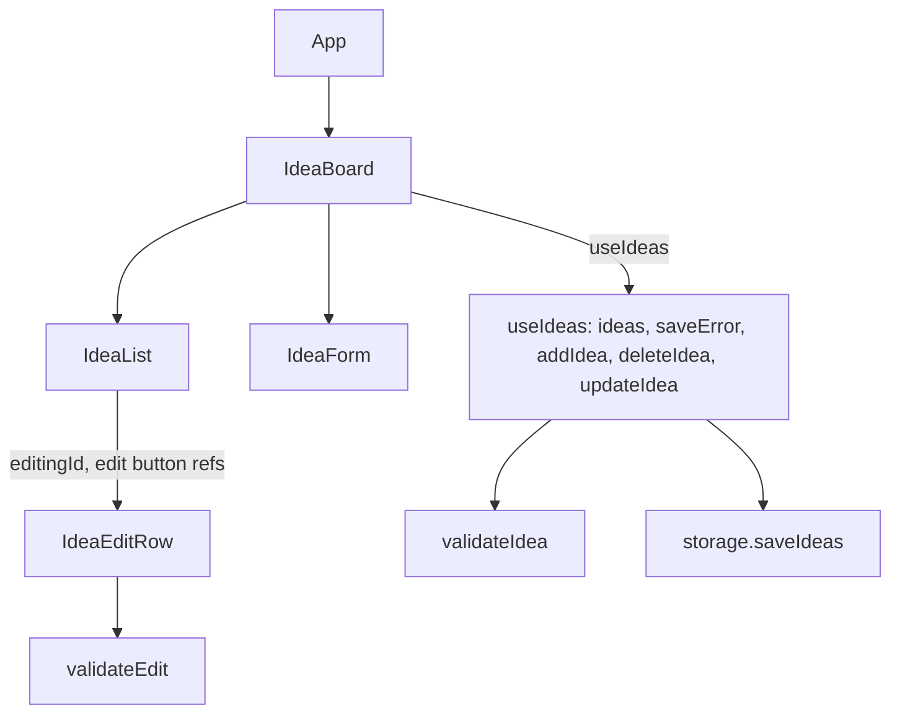
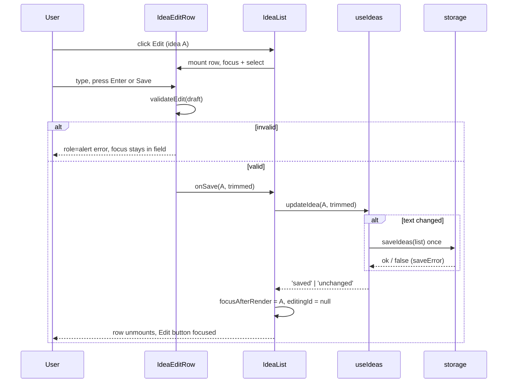

# Design Document

## Overview

This design adds in-place editing of an idea to the existing idea board. It covers the nine requirements in `requirements.md`. Ambiguity resolutions A1 to A18 in that file are treated as settled and are not repeated here.

The design adds one component (`IdeaEditRow`), one validator wrapper (`validateEdit`), one hook operation (`updateIdea`), and extends `IdeaList`. Nothing else changes. `storage.ts`, `types.ts`, `IdeaForm.tsx`, and the existing behaviour of `validateIdea` stay as they are.

Versions checked in `node_modules`: react 19.3.1, vitest 5.1.1, @testing-library/react 16.3.3, @testing-library/user-event 14.6.13. No new library API is used beyond what the existing code already calls (`useState`, `useRef`, `useId`, `useEffect`, `render`, `renderHook`, `userEvent.setup`). `fast-check` is not installed and is not added.

### Design decisions to confirm

These extend or interpret a requirement. Overrule any before approving.

1. **Unchanged text and Requirement 9.3.** Requirement 9.3 says a valid `updateIdea` call writes once. Requirement 2.7 says saving unchanged text makes zero writes. The design reconciles them: `updateIdea` returns `'unchanged'` and writes nothing when the trimmed text equals the current text. Requirement 9.3 is read as applying to text that differs.
2. **`updateIdea` returns a result.** The signature is `updateIdea(id, text): UpdateResult` with `'saved' | 'unchanged' | 'invalid' | 'not-found'`. Requirement 9 does not name a return value. The caller needs it to know whether to leave Edit_Mode.
3. **`updateIdea` validates by itself**, using `validateIdea`, even though the edit row validates first to get the message. Requirement 9.5 requires this. The row uses `validateEdit` for the user-facing message only.
4. **Edit state lives in `IdeaList`**, not `IdeaBoard`. `IdeaBoard` gets no new state. `IdeaList` gains a required prop `onUpdate`, so existing `IdeaList.test.tsx` renders must pass it.
5. **Edit_Mode is derived, not cleaned up.** `editingId` is kept in state, and an idea is in Edit_Mode only if `editingId` matches an idea currently in `ideas`. Deleting the edited idea therefore ends Edit_Mode with no effect or extra handler (Requirement 6.1). A deleted id is never reused because ids are `crypto.randomUUID()`.
6. **The edit field sits inside a `<form>`** (`noValidate`) so Enter submits natively (Requirement 2.2, A8). The Delete button stays outside this form, so Escape handling on the form does not fire for Delete.
7. **Edit_Button label text** is "Edit", Save_Button "Save", Cancel_Button "Cancel", with the `aria-label` values from A13.
8. **`validateEdit`** is a new exported wrapper in `validate.ts`. `validateIdea`, `EMPTY_MESSAGE`, and their tests are untouched.

## Architecture



State ownership:

| State | Owner | Why |
|---|---|---|
| `ideas`, `saveError` | `useIdeas` | Unchanged. `commit()` is reused so `saveError` matches add and delete (A10, Requirement 7). |
| `editingId: string \| null` | `IdeaList` | Only the list needs it. One value gives "one edit at a time" (Requirement 5) by construction. |
| draft text, edit error | `IdeaEditRow` (local `useState`) | Unmounting the row on switch, cancel, save, or delete discards both with no cleanup code (Requirements 4.1, 4.5, 5.1, 5.4, 6.1). |
| focus target after save or cancel | `IdeaList` (`useRef` holding an id, plus a `Map` of Edit buttons) | The Edit button for that idea does not exist until the row unmounts, so focus is applied in an effect after the render. |

## Components and Interfaces

| Unit | File | Interface | Responsibility |
|---|---|---|---|
| `EDIT_EMPTY_MESSAGE`, `validateEdit` | `src/ideas/validate.ts` | `validateEdit(raw: string): ValidationResult` | Calls `validateIdea`. If the failure message is `EMPTY_MESSAGE`, returns `EDIT_EMPTY_MESSAGE` ("Enter some text before saving.") instead. Over-length keeps `TOO_LONG_MESSAGE`. Success is passed through. |
| `useIdeas` | `src/ideas/useIdeas.ts` | adds `updateIdea(id: string, text: string): UpdateResult`; exports `type UpdateResult` | See below. |
| `IdeaEditRow` | `src/ideas/IdeaEditRow.tsx` (new) | props `{ idea: Idea; onSave: (id: string, text: string) => void; onCancel: (id: string) => void }` | Renders the edit form: Edit_Field, Save_Button, Cancel_Button, Edit_Error. Owns draft and error state. |
| `IdeaList` | `src/ideas/IdeaList.tsx` | props `{ ideas; onDelete; onUpdate: (id, text) => UpdateResult }` | Chooses view or edit per item, owns `editingId`, restores focus. |
| `IdeaBoard` | `src/ideas/IdeaBoard.tsx` | passes `updateIdea` as `onUpdate` | One-line change. |

### `updateIdea` contract

```ts
export type UpdateResult = 'saved' | 'unchanged' | 'invalid' | 'not-found'

function updateIdea(id: string, text: string): UpdateResult {
  const current = ideas.find((i) => i.id === id)
  if (!current) return 'not-found'                 // 9.4: no state change, no write
  const result = validateIdea(text)
  if (!result.ok) return 'invalid'                 // 9.5: no state change, no write
  if (result.text === current.text) return 'unchanged' // 2.7: no write, saveError untouched
  commit(ideas.map((i) => (i.id === id ? { ...i, text: result.text } : i))) // 9.1, 9.2, 9.3, 9.6
  return 'saved'
}
```

The return value is computed synchronously from the `ideas` array of the current render, the same array `addIdea` and `deleteIdea` use through `commit`. The result therefore cannot disagree with what is committed. React batches one event handler's state updates, and the row calls `onSave` once per user action. The existing hook has the same single-call-per-render assumption, so no functional `setIdeas` updater is introduced. `{ ...i, text }` keeps `id` and `createdAt` (A5, 9.1) and `map` keeps order and other ideas (9.2).

### `IdeaEditRow`

Markup, inside the `<li>` that `IdeaList` renders for that idea:

```tsx
<form className="idea-edit" noValidate onSubmit={handleSubmit} onKeyDown={handleKeyDown}>
  <label htmlFor={inputId} className="idea-edit-label">Edit idea</label>   {/* visually hidden */}
  <input id={inputId} ref={inputRef} type="text" value={draft}
         onChange={handleChange} aria-invalid={error !== null}
         aria-describedby={error !== null ? errorId : undefined} autoComplete="off" />
  <button type="submit"  aria-label={`Save idea: ${idea.text}`}>Save</button>
  <button type="button"  aria-label={`Cancel editing idea: ${idea.text}`} onClick={() => onCancel(idea.id)}>Cancel</button>
  {error !== null && <p id={errorId} role="alert" className="idea-error">{error}</p>}
</form>
```

- No `maxLength` attribute (Requirement 1.7).
- `useId` for `inputId` and `errorId`, same pattern as `IdeaForm`.
- `const [draft, setDraft] = useState(idea.text)`: the exact saved text, untrimmed (1.2, 8.6).
- `useEffect(() => { inputRef.current?.focus(); inputRef.current?.select() }, [])` runs on mount: focus (1.3, 5.5) and select the full text (1.8). Running twice under StrictMode is harmless.
- `handleSubmit`: `preventDefault()`, then `validateEdit(draft)`. On failure, `setError(message)` and `inputRef.current?.focus()` (3.8). On success, `onSave(idea.id, result.text)`.
- `handleChange`: `setDraft(value)` and `setError(null)` (3.9, A12).
- `handleKeyDown` on the form: if `event.key === 'Escape'`, `onCancel(idea.id)`. The form contains only the field and the two buttons, so Escape applies exactly where A17 says. Enter and Space on buttons use native button behaviour (8.5).
- Blur has no handler (4.8).
- The idea's text is only ever placed in `value` and in `aria-label` attribute strings, never as HTML (8.3, 8.6).

### `IdeaList` changes

```tsx
const [editingId, setEditingId] = useState<string | null>(null)
const focusAfterRender = useRef<string | null>(null)
const editButtons = useRef(new Map<string, HTMLButtonElement>())

useEffect(() => {
  if (focusAfterRender.current !== null) {
    editButtons.current.get(focusAfterRender.current)?.focus()
    focusAfterRender.current = null
  }
})   // runs after each render; no-ops unless a focus request is pending

function finishEdit(id: string) { focusAfterRender.current = id; setEditingId(null) }
function handleSave(id: string, text: string) {
  const result = onUpdate(id, text)
  if (result === 'saved' || result === 'unchanged') finishEdit(id)   // 'invalid' / 'not-found': stay
}
```

Per item: `const editing = idea.id === editingId` (derived from the current `ideas`, since only mapped ideas are checked, decision 5).

- View mode: `<span className="idea-text">`, Edit button (`aria-label="Edit idea: <text>"`, `onClick={() => setEditingId(idea.id)}`, ref callback registers and unregisters it in `editButtons`), and Delete button.
- Edit mode: `<IdeaEditRow key-less, inside li>` and the Delete button. No Edit button is rendered (1.10).
- Switching ideas: clicking Edit on B sets `editingId` to B. A's row unmounts, so its draft and error are discarded (5.1, 5.4). B's row mounts and focuses its field (5.5). No storage call is made (5.6).
- Delete: `onDelete` is unchanged. If the deleted id was `editingId`, that id is no longer in `ideas`, so no row renders. A stale `editingId` that matches nothing is harmless (6.1). Deleting another idea leaves `editingId` and the row's local draft untouched (6.2), because the row keeps its position-independent `key={idea.id}` on the `<li>`.
- The `aria-live="polite"` wrapper and `<ul aria-label="Ideas">` are unchanged (8.2).

### Data flow



## Data Models

No change to `Idea` (`{ id, text, createdAt }`), `MAX_IDEA_LENGTH` (140), or the storage key and format. New types and constants:

```ts
export type UpdateResult = 'saved' | 'unchanged' | 'invalid' | 'not-found'   // useIdeas.ts
export const EDIT_EMPTY_MESSAGE = 'Enter some text before saving.'            // validate.ts
```

Edit state (`editingId`, draft, error) is never persisted.

### CSS (class names only, in `src/App.css`)

`.idea-edit` (flex row container for field and buttons), `.idea-edit-label` (visually hidden label), `.idea-edit input` (field styling, with `[aria-invalid='true']` border reusing `--danger`), `.idea-actions` (wrapper grouping the buttons in view mode, if needed for layout). Existing `.idea-error` is reused for the Edit_Error. Any secondary button style for Cancel is `.button-secondary`.

## Error Handling

| Situation | Behaviour | Requirement |
|---|---|---|
| Empty or whitespace-only edit | `EDIT_EMPTY_MESSAGE` in `role="alert"`, `aria-invalid`, `aria-describedby`, focus in field, no write | 3.1, 3.4, 3.5, 3.6, 3.7, 3.8, 2.9 |
| Over 140 characters after trim | `TOO_LONG_MESSAGE`, same treatment | 3.2 |
| Exactly 140 characters | Accepted | 3.3 |
| Text changes while an error shows | Error and `aria-invalid` cleared | 3.9 |
| Same text after trim | Leave Edit_Mode, no write, `saveError` untouched | 2.7 |
| Storage write fails on save | `commit` sets `saveError`; the list keeps the new text; row leaves Edit_Mode; existing board message shows; no Edit_Error | 2.10, 7.1, 7.2, 7.3 |
| Later successful write | `commit` clears `saveError` (add, delete, or save) | 7.4 |
| `saveError` while cancelling or switching edit | Neither calls `commit`, so `saveError` stays | 7.5 |
| `updateIdea` with unknown id or invalid text | No state change, no write, returns `'not-found'` / `'invalid'` | 9.4, 9.5 |
| Corrupt or missing storage | `loadIdeas` returns `[]` (unchanged); nothing to edit | A16 |

## Correctness Properties

Generated-input testing does not apply here: `fast-check` is not installed and the rules forbid adding dependencies. The two `FOR ALL` criteria are expressed as table-driven Vitest cases (`it.each`) over hand-written case tables. They are example-based tests over a fixed, enumerated case set, not random generation, and they make no claim beyond those cases.

### Property 1: Update preserves length and id order

For every case in the table, after `updateIdea(targetId, text)` returns `'saved'`, `ideas.length` and `ideas.map(i => i.id)` equal their values before the call.

Case table, generated with nested loops in the test file, no random values:

- list sizes: 1, 2, 5
- target position: first, middle, last (a position is skipped when it does not exist for the size: size 1 has only first, size 2 has first and last)
- new text length: 1, 70, 140 characters, built as `'x'.repeat(n)` and made different from the existing text so the result is `'saved'`

Size 1 has 1 position, size 2 has 2, size 5 has 3, each with 3 text lengths: 3 + 6 + 9 = 18 cases.

**Validates: Requirements 9.7**

### Property 2: Save then load round trip

For every case in the same table, after `updateIdea` returns `'saved'`, `loadIdeas()` deep-equals `result.current.ideas`.

**Validates: Requirements 9.8**

(Other criteria are covered by example tests in the traceability table.)

## Testing Strategy

Rules applied, from `.kiro/steering/testing.md`: Vitest 5.1.1 with jsdom and React Testing Library, run with `npm test` (`vitest run`, no watch). Tests sit beside the code as `<name>.test.ts(x)`. `src/test/setup.ts` already clears `localStorage` in `beforeEach` and calls `cleanup()` in `afterEach`, so every test is independent. No test uses the network. A failing test is fixed in the code and never weakened. Storage failure is simulated with `vi.spyOn(Storage.prototype, 'setItem').mockImplementation(() => { throw new Error() })` and restored in `afterEach`, following `useIdeas.test.tsx`. Write counts are measured with `vi.spyOn(Storage.prototype, 'setItem')`. Focus is checked with `expect(el).toHaveFocus()`. Selection is checked with `selectionStart === 0` and `selectionEnd === value.length`. Tab order uses `user.tab()`.

Test files:

| File | Scope |
|---|---|
| `src/ideas/validate.test.ts` (extend) | `validateEdit` |
| `src/ideas/useIdeas.test.tsx` (extend) | `updateIdea`, Properties 1 and 2 |
| `src/ideas/IdeaEditRow.test.tsx` (new) | Row in isolation with `vi.fn()` callbacks |
| `src/ideas/IdeaList.test.tsx` (extend) | List-level edit state; existing renders gain `onUpdate={vi.fn()}` |
| `src/ideas/IdeaBoard.test.tsx` (extend) | End to end through the real hook and `localStorage` |

Definition of done (from the workspace rules): `npm test`, `npm run lint`, `npm run build` all pass with output shown.

### Requirement-to-test traceability

One test per criterion. "Row" is `IdeaEditRow.test.tsx`, "List" is `IdeaList.test.tsx`, "Board" is `IdeaBoard.test.tsx`, "Hook" is `useIdeas.test.tsx`, "Val" is `validate.test.ts`.

| Criterion | File | Test (what it asserts) |
|---|---|---|
| 1.1 | List | One button named "Edit idea: <text>" per idea in view mode |
| 1.2 | List | Click Edit: field value equals saved text exactly, including leading and trailing spaces; text span gone |
| 1.3 | Row | On mount the field has focus |
| 1.4 | Row | Exactly one button named "Save idea: <text>" |
| 1.5 | List | Delete button for the edited idea is present |
| 1.6 | Row | `getByLabelText('Edit idea')` finds the field |
| 1.7 | Row | Field has `type="text"` and no `maxLength` attribute |
| 1.8 | Row | `selectionStart` 0, `selectionEnd` equals length |
| 1.9 | Row | Exactly one button named "Cancel editing idea: <text>" |
| 1.10 | List | In edit mode no button named "Edit idea: <text>" for that idea |
| 2.1 | Row | Click Save with valid text: `onSave(id, trimmed)` called once |
| 2.2 | Row | Enter in field: same single `onSave` call |
| 2.3 | Board | After save, edited idea is at the same index |
| 2.4 | Hook | `id` and `createdAt` unchanged after `updateIdea` |
| 2.5 | Board | One `setItem` call on a changed save; `loadIdeas()` after re-render of a fresh board shows edited text |
| 2.6 | Board | After save `document.activeElement` is the idea's Edit button |
| 2.7 | Board | Save same text (also with extra surrounding spaces): row closes, text unchanged, zero `setItem` calls |
| 2.8 | Hook | Other ideas deep-equal before and after |
| 2.9 | Row | Invalid text: `onSave` not called, error shown, field still present |
| 2.9 (no write) | Board | Invalid save: zero `setItem` calls, stored text unchanged |
| 2.10 | Board | `setItem` throws: edited text shown, row closed, "Could not save your ideas in this browser." shown |
| 3.1 | Row | Empty draft: alert text "Enter some text before saving." |
| 3.2 | Row | 141 characters: alert text "Ideas can be at most 140 characters." |
| 3.3 | Row | Exactly 140 characters: `onSave` called, no error |
| 3.4 | Row | Whitespace-only draft (spaces, tab, newline cases via `it.each`): edit message, field remains |
| 3.5 | Board | After rejected edit, list text and `localStorage` unchanged |
| 3.6 | Row | Error element has `role="alert"` |
| 3.7 | Row | Field `aria-invalid="true"` and `aria-describedby` equals the error element id |
| 3.8 | Row | After a rejected save by button click, field has focus |
| 3.9 | Row | Typing after an error removes the alert and `aria-invalid` is not `true` |
| 3.10 | Board | Add form with empty input shows "Enter an idea before adding it." (regression) |
| 4.1 | Row | Click Cancel: `onCancel(id)` called, `onSave` not called |
| 4.1 (display) | Board | After typing then Cancel, original text shown |
| 4.2 | Row | Escape in field calls `onCancel` |
| 4.3 | Row | Escape focused on Save, and again on Cancel (two `it.each` cases) calls `onCancel` |
| 4.4 | Board | After Cancel, active element is the Edit button |
| 4.5 | Board | Error shown, Cancel, Edit again: no alert |
| 4.6 | Board | Cancel: zero `setItem` calls, stored value unchanged |
| 4.7 | Board | Cancel keeps order and other texts |
| 4.8 | Row | Tab away from the field: field still present, draft and error unchanged |
| 5.1 | List | Edit A, type, click Edit B: A shows saved text |
| 5.2 | List | Same sequence: B has a field |
| 5.3 | List | Same sequence: `getAllByRole('textbox')` within the list has length 1 |
| 5.4 | List | A showed an error, switch to B: no alert in the document |
| 5.5 | List | After switch B's field has focus |
| 5.6 | Board | Switch: zero `setItem` calls, stored list identical |
| 6.1 | Board | Delete the edited idea: idea gone, no textbox in list, storage lacks the draft |
| 6.2 | Board | Delete another idea: edited row remains with typed draft unchanged |
| 6.3 | Board | Add a valid idea while editing: new idea present, draft unchanged |
| 6.4 | Board | While editing, Add input and Add button are enabled |
| 6.5 | Board | Invalid add during edit: Add message shown, no idea added, draft unchanged |
| 7.1 | Board | Failed write: save error visible immediately after the save click returns |
| 7.2 | Board | Failed write: trimmed new text at same position |
| 7.3 | Board | Failed write: no textbox, no edit error |
| 7.4 | Board | After a failure, a successful add clears the error; same for delete and for a changed save (three `it.each` cases) |
| 7.5 | Board | With error shown: Cancel and start another edit, error still shown |
| 8.1 | Board | `user.tab()` sequence visits Edit buttons, then field, Save, Cancel exactly once in order |
| 8.2 | List | `aria-live="polite"` wrapper present in view and edit mode |
| 8.3 | Board | Save `<b>x</b>`: shown as text, `document.querySelector('b')` is null |
| 8.4 | Board | After save, buttons named with new text exist, previous-text names do not |
| 8.5 | Row | Focused Save and Cancel activated with Enter and with Space behave like click (`it.each`) |
| 8.5 (Edit button) | List | Focused Edit button with Enter and Space opens the field |
| 8.6 | List | Stored text `<b>x</b>` appears verbatim as field value |
| 9.1 | Hook | `updateIdea` replaces text with trimmed text, keeps `id`, `createdAt` |
| 9.2 | Hook | Other ideas unchanged |
| 9.3 | Hook | One `setItem` call and stored list equals new list |
| 9.4 | Hook | Unknown id: `'not-found'`, list unchanged, zero `setItem` calls |
| 9.5 | Hook | Empty, whitespace-only, 141 characters (`it.each`): `'invalid'`, list unchanged, zero `setItem` calls |
| 9.6 | Hook | `setItem` throws: list holds new text, `saveError` true |
| 9.7 | Hook | Property 1 table, 18 `it.each` cases |
| 9.8 | Hook | Property 2 table, 18 `it.each` cases |
| Extra | Val | `validateEdit('')` returns `EDIT_EMPTY_MESSAGE`; over-length and success unchanged; `validateIdea('')` still returns `EMPTY_MESSAGE` |
| Extra | Hook | `updateIdea` same trimmed text returns `'unchanged'`, zero writes, `saveError` stays as it was (supports 2.7, A2) |

### Not tested

Static markup and CSS (class names above) have no logic and need no test, per the workspace testing rules.
