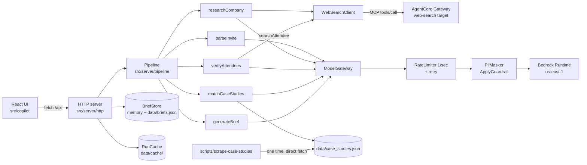
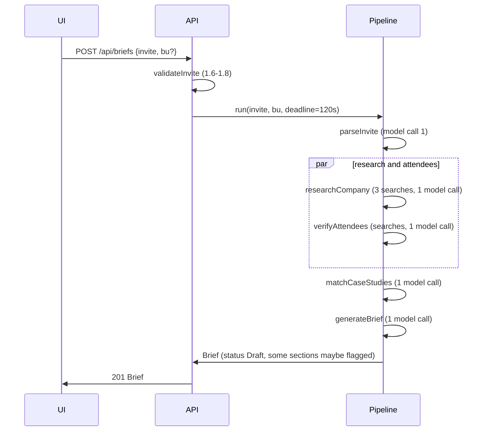

# Design Document

## Overview

The Inside Sales Copilot turns a pasted meeting invite into a cited discovery brief. The SE edits sections inline and approves. Approval locks the brief and enables a Markdown export. Scope comes from `docs/brd-inside-sales-copilot.md` and `requirements.md`. Nothing in this design adds a requirement. Where the requirements leave a point open (Ambiguities A1 to A15), this design states an assumption and marks it "Assumption" so a person can confirm or reverse it before the design is approved.

### Stack decision (resolves A11)

| | Draft plan and architecture doc | Repository steering | Chosen |
|---|---|---|---|
| UI | Next.js | React 19 + Vite 8, plain CSS | **React 19 + Vite 8** (existing app) |
| Backend | Python, FastAPI, Pydantic, pytest | None ("client-side only unless the user asks") | **Node.js 24 + TypeScript, small HTTP server** (Hono) |
| Agent framework | Strands Agents | none | **None.** Fixed pipeline of typed functions |
| Tests | pytest | Vitest + React Testing Library | **Vitest** |

Rationale:

1. **A backend is required, and the steering allows it.** The product steering says the app stays client-side "unless the user asks for a backend". The brief requires Amazon Bedrock, Bedrock Guardrails and an AgentCore Gateway. These need AWS credentials, which must never be in browser code (AGENTS.md: no secrets in code). This feature is therefore the explicit request for a server. The server holds all credentials and all calls to AWS and the web.
2. **Keep the repository's toolchain.** `testing.md` fixes Vitest, and the done-gate is `npm test`, `npm run lint`, `npm run build`. `tech.md` fixes TypeScript, ESLint and npm. A Python backend would add a second language, a second test runner, a second lint and scan setup, and would break the done-gate. One language also lets the UI and the server share types (`import type`).
3. **Next.js is dropped.** The repository already has a Vite app, and the feature needs one page. Replacing the build would break the existing idea-board.
4. **Strands is dropped.** The architecture doc itself says "fixed pipeline, not multi-agent". Each step is one typed function that makes one structured model call. A framework adds a dependency whose installed API would need verification and gives nothing the fixed pipeline needs.
5. **Cost of the choice.** The plan's Python and Strands references are not reused. The team members assigned to Python backend work (draft plan owners table) work in TypeScript instead. This needs the team's acceptance and is the first item in "Decisions needing a person" below.

The existing idea-board code in `src/ideas/` is not touched.

### Decisions needing a person

| # | Decision | Design assumption |
|---|---|---|
| D1 | Stack (A11) | TypeScript backend + existing React/Vite UI, as above |
| D2 | `structure.md` says all application code lives in `src/` | Server code goes in `src/server/`, UI in `src/copilot/`. `structure.md` and `product.md` need an update, since `product.md` currently scopes the repo to the idea board only |
| D3 | New dependencies (see "Dependencies") | Added in task 1 with the user told which packages, per `testing.md` and `tech.md` |
| D4 | Unusable invites (A1) | Company is read only from the model's parse of the masked invite text. No inference from email domains, so no email data is needed after masking |
| D5 | Size boundaries (A2, A15) | enterprise > 5,000; mid-market 500 to 5,000; SMB 50 to 499; boutique 1 to 49, as in Requirement 3.2 |
| D6 | PII types (A7) | The guardrail masks EMAIL and PHONE. NAME is not masked, because attendee verification needs names. Masked values are not restored in the displayed Brief |
| D7 | Re-open approved brief (A5) | Not possible. No endpoint or control exists |
| D8 | Failure scope (A8) | Section-to-step map in "Partial results" below |
| D9 | Storage (A12) | In memory, mirrored to `data/briefs.json` so a restart keeps briefs. No database |
| D10 | Cached run (A10) | Cached Brief keyed by a hash of the normalized Invite text. Only an Invite that was run before can be replayed offline |

## Architecture

All code runs on one local machine. The browser talks to a local server. The server talks to AWS (Bedrock, Guardrails, AgentCore Gateway) in `us-east-1` and, for the one-time scrape, to royalcyber.com.



### Layers and rules

- **Domain (pure, no I/O).** Size tier, fact validation, attendee match, case-study validation, section state machine, partial-result assembly, Markdown export, invite validation. These carry the correctness properties.
- **Adapters (I/O).** `ModelGateway`, `WebSearchClient`, `BriefStore`, `RunCache`, scraper. Each is an interface with a real and a fake implementation, so the pipeline is tested without the network.
- **Only `ModelGateway` imports the Bedrock client** (Requirement 9.3). A test greps the source tree for any other import of `@aws-sdk/client-bedrock-runtime`.
- **All attendee search goes through one function**, `searchAttendee(attendee)` (Requirement 4.9), so a guardrail can be added there later (A3).

### Pipeline



`parseInvite` must finish first. Research and attendee verification then run concurrently. Their web searches run in parallel. Their model calls queue behind the one-per-second limiter. The matcher needs the company profile, so it runs after research. The generator runs last.

### Time budget (Requirement 11.1)

Every model call is up to three Bedrock Runtime requests (input guardrail, model, output guardrail), and each counts against the one-per-second limit. The pipeline makes 5 model calls (parse, research synthesis, attendee extraction in one batched call, matching, generation). That is 15 limited requests, so about 15 seconds of mandatory spacing, plus model latency and search time. This leaves room inside 120 seconds. Retries add requests. If a run needs more, the 120-second deadline applies (see "Error Handling").

Verification of all attendees uses one batched extraction call, not one call per attendee, so the time does not grow with the attendee count (resolves the concern in A9). Searches are not Bedrock requests and run in parallel.

### Dev and run commands (Requirement 12.1)

One documented command, `npm run start:local`, runs `scripts/start-local.mjs`. It starts the server and the Vite dev server as two child processes. The agent does not run it (steering: never start the dev server from the agent shell). The user runs it. The Vite dev server proxies `/api` to the server. Because `vite.config.ts` sets `base: '/absproxy/5173/'` for serve, the proxy rule and the UI's fetch URLs must use that prefix (`import.meta.env.BASE_URL + 'api/...'`). The first task probes this with a request through the proxy and reports the result, instead of assuming it.

## Components and Interfaces

### Verified library facts

Checked on 2026-11-20 by installing in a scratch directory (`/tmp`, not in the repository). They must be re-read in the real `node_modules` when the dependencies are installed (`verify-first.md`). Versions are the latest on the npm registry at that time.

| Package | Version checked | Facts verified in installed type declarations |
|---|---|---|
| `@aws-sdk/client-bedrock-runtime` | 3.1174.0 | `ApplyGuardrailCommand` and `ConverseCommand` exist. `ApplyGuardrailRequest` has `guardrailIdentifier`, `guardrailVersion`, `source` (`INPUT` or `OUTPUT`), `content`. `ApplyGuardrailResponse` has `action` (`GUARDRAIL_INTERVENED` or `NONE`), `outputs`, `assessments`. `ConverseCommandInput` has `guardrailConfig` |
| `@modelcontextprotocol/sdk` | 1.32.2 | `Client` has `listTools` and `callTool`. `StreamableHTTPClientTransport` takes a `URL` and options that include a custom `fetch` |
| `hono` / `@hono/node-server` | 4.13.19 / 2.1.11 | Not yet read. Verify in task 1 |
| `cheerio` | 1.2.0 | Not yet read. Verify in the scraper task |
| `fast-check` | 4.10.3 | Not yet read. Verify in task 1 |

Not verified, and so not relied on: how to sign requests to a Gateway that uses IAM (SigV4) inbound auth, and the exact shape of the `WebSearch` tool result. Both are settled in the connectivity spike (task 1). If the SDK's `fetch` option can carry a signing wrapper, the Gateway uses IAM. If not, the Gateway uses JWT. The `WebSearchClient` interface hides this choice from the rest of the code.

### Dependencies to add (D3)

Runtime: `@aws-sdk/client-bedrock-runtime`, `@modelcontextprotocol/sdk`, `hono`, `@hono/node-server`, `cheerio` (scraper only). Dev: `fast-check`, `tsx` or Node's native TypeScript stripping for running server code (Node 24 is installed; verify which works with `erasableSyntaxOnly`). The user is told which packages are added. No other dependency is added.

### Server modules (`src/server/`)

```ts
// domain/types.ts (shared with the UI through `import type`)
export type SizeTier = 'enterprise' | 'mid-market' | 'SMB' | 'boutique'
export type SectionId =
  | 'companySnapshot' | 'attendees' | 'painPoints'
  | 'caseStudies' | 'agenda' | 'questions'
export type StepId = 'research' | 'attendees' | 'matching' | 'generation'
export type BriefStatus = 'draft' | 'approved'

export interface SourceLink { url: string; title: string }
export interface Fact { claim: string; sources: SourceLink[] }   // 1..3 after validation
```

| Module | Responsibility | Key signature |
|---|---|---|
| `domain/invite.ts` | `validateInvite` for 1.6 to 1.8 | `validateInvite(text: string): { ok: true } \| { ok: false; code: 'EMPTY' \| 'TOO_LONG' }` |
| `domain/sizeTier.ts` | Requirement 3.2 mapping | `sizeTierFor(employees: number): SizeTier \| null` |
| `domain/facts.ts` | Requirement 2.1, 2.2, 2.5 | `validateFacts(raw: RawFact[]): Fact[]` (drops facts without 1 to 3 valid http(s) links, keeps the first 3 links) |
| `domain/attendeeMatch.ts` | Requirement 4.2, 4.3, 4.5, 4.6 | `decideAttendee(inv: InviteAttendee, pages: CandidatePage[]): AttendeeResult` |
| `domain/caseStudies.ts` | Requirement 5.1 to 5.5 | `selectCaseStudies(snapshot, picks, bu?): { selected: MatchedCaseStudy[]; shortfall: boolean }` |
| `domain/brief.ts` | State machine: `editSection`, `approve`, `canExport` | pure functions returning a new Brief or a typed error |
| `domain/partial.ts` | Requirement 10 | `assembleSections(results: StepResults): Section[]` |
| `domain/exportMarkdown.ts` | Requirement 8 | `exportMarkdown(b: Brief): string` (throws if not approved) |
| `adapters/modelGateway.ts` | Requirement 9, 11.2, 11.3, 11.6 | `ModelGateway.invoke<T>(req): Promise<T>` |
| `adapters/rateLimiter.ts` | Requirement 11.2 | `createLimiter(minGapMs, clock)` |
| `adapters/webSearch.ts` | MCP client for the Gateway `WebSearch` tool | `WebSearchClient.search({query, maxResults, signal})` |
| `adapters/briefStore.ts` | Memory + JSON file | `get`, `put` |
| `adapters/runCache.ts` | Requirement 12.5 | `get(inviteHash)`, `put(inviteHash, brief)` |
| `steps/*.ts` | `parseInvite`, `researchCompany`, `verifyAttendees`, `matchCaseStudies`, `generateBrief` | each takes injected `ModelGateway` and `WebSearchClient` |
| `pipeline.ts` | Orchestration, deadline, partial results | `runPipeline(deps, input, signal): Promise<Brief>` |
| `http/app.ts` | Routes | see below |
| `scripts/scrape-case-studies.ts` | One-time scrape (Requirement 5.6) | writes `data/case_studies.json` |

### ModelGateway (Requirements 9, 11.2, 11.3, 11.6)

Every Bedrock request goes through `ModelGateway`, in this order:

1. Wait for the limiter (one request start per 1,000 ms).
2. `ApplyGuardrail` with `source: INPUT` on the prompt text. If `action` is `GUARDRAIL_INTERVENED`, use the returned `outputs` text. The masked text replaces the original.
3. `Converse` with the masked prompt (limiter again).
4. `ApplyGuardrail` with `source: OUTPUT` on the model text (limiter again). The masked text is what the caller receives.

If either guardrail call throws, or returns no usable text, the gateway returns `PII_MASKING_FAILED` and does not send the request or pass on the response. The error carries no prompt or response text (Requirement 9.4).

The gateway builds its client with `region: 'us-east-1'` fixed in code (Requirement 11.3). No setting overrides it.

Rate-limit errors (throttling or quota) are retried at most 3 times, waiting at least 1,000 ms before each retry, and each attempt passes through the limiter. After 3 failed retries the gateway returns `RATE_LIMITED` (Requirement 11.6). The exact error names the SDK throws for throttling are read from the installed package when the gateway is written.

Using explicit `ApplyGuardrail` calls, not `guardrailConfig` on `Converse`, is a choice for testability: the masked text is visible and fail-closed behavior is deterministic. The cost is two extra limited requests per model call, covered in the time budget. The spike confirms that a Guardrail with EMAIL and PHONE actions of `ANONYMIZE` returns masked text through `outputs`. If it does not, the design returns to the team before building further.

The model ID is read from configuration (`COPILOT_MODEL_ID`) and is not fixed in this document, as in the architecture doc. The Guardrail ID and version are also configuration. Neither is a secret, but both stay out of the repository's committed files in favor of `.env.local` (git-ignored by `*.local`).

### WebSearchClient (Requirements 2, 4)

An MCP client calls the Gateway's `WebSearch` tool (`query` up to 200 characters, `maxResults` 1 to 25, as documented in the plan). Results are parsed into `{ url, title, snippet, publishedDate? }`. Results are used in memory for one run and are not indexed or stored in bulk (A13). The run cache stores only the finished Brief with its source links, which the terms require to be kept and shown.

Company research makes three searches (overview and size, recent news with a published-date filter, challenges). Search errors map to the step failing (see "Partial results").

### researchCompany

One model call receives the masked search snippets and returns structured facts in four groups: industry, employee count, news items, pain points. Each fact lists the URLs of the search results it came from. In code:

1. Every URL the model returns must appear in the search results of this run. Others are dropped, so the model cannot invent a source.
2. `validateFacts` keeps facts with 1 to 3 valid links and drops the rest, with no placeholder (2.2).
3. If an employee-count fact survives, `sizeTierFor` assigns the tier from the number, and the supporting links are shown (3.1 to 3.3). If not, the snapshot shows "size not found" (3.4).
4. If no facts survive, the Brief states that no sourced facts were found (2.5).

The tier is computed in code, not by the model, so the thresholds are testable.

### verifyAttendees

For each Attendee, `searchAttendee` runs one web search (name and employer) with a 10-second `AbortSignal.timeout`. A timeout or error gives `Unverified: search failed` and the others continue (4.4). One batched model call turns all result snippets into candidate pages `{ attendeeIndex, url, title, employer, jobTitle }`. The model only extracts. **Code decides the status** in `decideAttendee`:

- Normalize with: Unicode lower-case, trim, remove punctuation, collapse whitespace.
- A page matches when normalized employer and normalized title both equal the Invite entry's (4.2).
- Verified: at least one matching page. Store the first matching page's URL in result order (exactly one, 4.6).
- Unverified: choose exactly one reason (4.5): no pages → `no public information found`; pages exist, employer matches somewhere but title never matches → `title does not match`; title matches somewhere but employer never matches → `employer does not match`; otherwise → `employer and title do not match`. Store no link (4.3).

Invite fields missing for an Attendee (empty employer or title) cannot match, so that Attendee is Unverified. Only invented values would change that, and the code never supplies one (1.5).

### matchCaseStudies

1. The loader reads `data/case_studies.json` and applies the BU filter if the SE chose one.
2. A shortlist by industry and technology is built in code. The model gets the shortlist and the company profile and returns up to 3 picks, `{ id, reason }`.
3. `selectCaseStudies` keeps a pick only if its ID is in the eligible snapshot records, drops duplicates, trims to 3, and rejects reasons that are empty or longer than 300 characters by dropping the pick. It never fills from another BU (5.5). `shortfall` is true when fewer than 3 remain, and the Brief says so (including when there are none).
4. The displayed link is the snapshot record's own URL (5.7).

The reason must name an attribute (industry, size tier or pain point). The prompt requires it. The code checks length only. Whether the reason really names an attribute is a model-quality matter and gets a manual review in the demo rehearsal (not an automated property).

### generateBrief

One model call produces agenda and questions from the earlier outputs. The pain-point hypotheses and the case studies come from the earlier steps and are not regenerated, so facts keep their links.

### Partial results (Requirement 10, assumption D8)

| Section | Depends on steps |
|---|---|
| companySnapshot | research |
| painPoints | research |
| attendees | attendees |
| caseStudies | research, matching |
| agenda | research, generation |
| questions | research, generation |

A Section is flagged if any step it depends on failed. A flagged Section holds only a statement naming the failed step ("Company research failed: content unavailable") and an indicator. It never holds partial content from the failed step (10.3). If every step fails, every Section is flagged and the Brief carries the message that no research content could be produced (10.5). `parseInvite` is not a research step. If it fails, no Brief is produced and the SE sees an error (see Error Handling). If the generation step fails but research worked, agenda and questions are flagged and the rest stay (10.1).

### HTTP API (`src/server/http/app.ts`)

| Route | Purpose | Result |
|---|---|---|
| `POST /api/briefs` `{ invite, bu? }` | Run the pipeline | 201 Brief. 400 `EMPTY`, `TOO_LONG`, `NO_COMPANY`. 504 `TIME_LIMIT`. 502 `RATE_LIMITED`, `PII_MASKING_FAILED` |
| `GET /api/briefs/:id` | Read a Brief | 200 or 404 |
| `PATCH /api/briefs/:id/sections/:sectionId` `{ text }` | Save inline edit | 200 Brief. 400 `BLANK`. 409 `LOCKED`. 500 `NOT_SAVED` |
| `POST /api/briefs/:id/approve` | Approve | 200 Brief. 500 `APPROVAL_FAILED` leaves Draft |
| `GET /api/briefs/:id/export` | Markdown download | 200 `text/markdown` with `Content-Disposition: attachment`. 409 `NOT_APPROVED`. 500 `EXPORT_FAILED` |
| `GET /api/case-studies/bus` | BU list from the snapshot, for the optional selector | 200 `string[]` |

There is no route that sets an Approved Brief back to Draft (D7). The server listens on `127.0.0.1` only, with no authentication (A14: single user).

### UI (`src/copilot/`)

Follows the existing feature layout (`src/ideas/` is the model). `App.tsx` renders the new `CopilotPage` alongside, or in place of, the idea board. That placement is a product decision and is listed for the person approving the spec.

| Component | Role |
|---|---|
| `CopilotPage.tsx` | Holds Invite text, BU choice, run state, current Brief. Keeps the Invite text on every error (1.6 to 1.8, 11.5, 12.6) |
| `InviteForm.tsx` | Paste box, optional BU `select`, submit |
| `ProgressIndicator.tsx` | Shown immediately on submit (within 2 s, 11.4) until the Brief or an error appears |
| `BriefView.tsx` | Renders the Sections, status, cached-run banner |
| `SectionView.tsx` | One Section: text with facts and links, flag badge (10.4), edit/save/cancel while Draft |
| `SourceLinks.tsx` | Links on the same list item as the fact (2.3) |
| `AttendeeList.tsx` | Status, plus link (Verified) or reason (Unverified) |
| `ApproveBar.tsx` | Approve button and Export button (disabled, or hidden, while Draft) |
| `useBrief.ts` | Hook for the API calls. Client deadline of 120 s using `AbortController` |

The client timeout and the server deadline are both 120 s. The server deadline is checked first, so the client sees a 504 with a message in normal cases.

## Data Models

```ts
export interface InviteAttendee { name: string | null; title: string | null; employer: string | null }
export interface ParsedInvite { company: string | null; attendees: InviteAttendee[] }  // missing = null (1.5)

export type AttendeeResult =
  | { status: 'verified'; source: SourceLink }
  | { status: 'unverified'; reason:
      | 'no public information found' | 'employer does not match'
      | 'title does not match' | 'employer and title do not match' | 'search failed' }

export interface CaseStudyRecord {            // data/case_studies.json
  id: string; title: string; url: string; summary: string
  industry: string; technologies: string[]; bu: string
}
export interface MatchedCaseStudy { record: CaseStudyRecord; reason: string }

export interface Section {
  id: SectionId
  originalText: string                // never changes after generation (6.3, 6.7)
  editedText: string | null
  history: { text: string; savedAt: string }[]   // every saved edit, for the later learning feature
  sources: SourceLink[]               // structured links for this Section
  flag: { step: StepId; message: string } | null
}

export interface Brief {
  id: string
  company: string
  status: BriefStatus
  sizeTier: SizeTier | null           // null renders "size not found"
  sections: Section[]                 // fixed order, six Sections
  notices: string[]                   // e.g. "no sourced facts found", "fewer than 3 case studies"
  cached: boolean                     // true only for a replayed cached run
  createdAt: string
  approvedAt: string | null
}
```

Design choices on the Section model:

- **Text and links are stored separately.** `originalText` is generated Markdown with the link next to each fact (2.3). `sources` repeats those links in structured form. The SE can rewrite a Section freely, and the structured `sources` still holds every link. Display and export always render the Section text, then a "Sources" list built from `sources`, in the same Section (8.3). The count of distinct links in the export therefore equals the count in the Brief (8.5) even after edits. Assumption (A6): the export contains the Edited_Text where one exists.
- **`history` holds every saved edit**, `originalText` is untouched. This is the edit history Requirement 6.7 asks for.
- **Dates** are ISO 8601 strings so the JSON round trip is exact.

### Storage

`BriefStore` keeps Briefs in a `Map` and writes the whole map to `data/briefs.json` after each change, atomically (write to a temp file, then rename). A failed write returns `NOT_SAVED` or `APPROVAL_FAILED` and the in-memory Brief is left as it was (6.6, 7.4). `data/` is git-ignored except `data/case_studies.json`. The snapshot file is a committed deliverable once Sravani has reviewed the BU tags.

`RunCache` stores the last successful Brief per Invite hash in `data/cache/<hash>.json`. Before a run, the server makes a connectivity check to the Gateway host and Bedrock endpoint (3-second timeout). If it fails and a cache entry exists, the entry is returned with `cached: true`, and the UI shows a visible "Cached run" banner (12.5). If no entry exists, the SE sees the network error. Cached Briefs can still be edited, approved and exported, because the demo sequence must complete.

### Test data

Every fixture, test invite and cached demo Brief uses synthetic people and companies (`AGENTS.md`). Test invites use reserved example domains and fictitious names. The one real-world input is the company the user chooses at runtime for the live demo, as the requirements allow. Searches for real attendees are covered by A3 and wait for the mentor's answer. Until then the live demo uses synthetic attendee names.

## Correctness Properties

*A property is a characteristic or behavior that should hold true across all valid executions of a system-essentially, a formal statement about what the system should do. Properties serve as the bridge between human-readable specifications and machine-verifiable correctness guarantees.*

Reflection on the prework candidates, with the merges made: Size tier assignment (3.1, 3.2) and the "size not found" outcome (3.4) became two properties because one is about the number mapping and the other about the presence of a sourced count. Fact validation (2.1, 2.2, 2.5) is one property. The attendee rules (4.1 to 4.3, 4.5, 4.6) are one property because they are all outputs of `decideAttendee`. Section save (6.3, 6.7) and blank rejection (6.5) are separate because one holds for non-blank text and the other for blank text. Approval lock (7.1 to 7.3, 7.5) subsumes the "no edit control" rule at the state level (6.8). Export gating (8.1, 8.2), link equality (8.3, 8.5) and text version (8.4) became two properties, one for gating and one for content. Masking (9.1, 9.2) and fail-closed (9.4) are separate. The throttle (11.2) and the retry bound (11.6) are separate.

### Property 1: Invite validation

*For any* string, `validateInvite` accepts it if and only if it has at least one non-whitespace character and at most 10,000 characters. Whitespace-only and empty strings return `EMPTY`. Strings over 10,000 characters return `TOO_LONG`.

**Validates: Requirements 1.7, 1.8**

### Property 2: Fact validation keeps only cited facts

*For any* list of candidate facts, each with any number of links of any form, `validateFacts` returns only facts that each carry between 1 and 3 links, every link beginning with `http://` or `https://` and being a parseable URL, in the original order. Every dropped fact is absent from the output, and no placeholder fact is added.

**Validates: Requirements 2.1, 2.2**

### Property 3: Size tier mapping

*For any* integer employee count of 1 or more, `sizeTierFor` returns `boutique` for 1 to 49, `SMB` for 50 to 499, `mid-market` for 500 to 5,000, and `enterprise` for more than 5,000. Every such count gets exactly one tier.

**Validates: Requirements 3.1, 3.2**

### Property 4: Size tier is present only with a sourced employee count

*For any* set of validated facts, the Brief's size tier is non-null if and only if the set contains an employee-count fact with at least one link, and when it is non-null the supporting link appears in the snapshot Section's sources.

**Validates: Requirements 3.3, 3.4**

### Property 5: Attendee status decision

*For any* Invite attendee and any list of candidate pages, `decideAttendee` returns exactly one status. The status is `verified` if and only if some page has an employer and a title that both equal the attendee's after ignoring letter case, leading and trailing whitespace, and punctuation. A verified result stores exactly one link, taken from a matching page, and no reason. An unverified result stores no link and exactly one reason from the allowed set, chosen by which of employer and title matched on some page.

**Validates: Requirements 4.1, 4.2, 4.3, 4.5, 4.6**

### Property 6: Attendee match is invariant under normalization

*For any* attendee and any candidate page that matches, changing the page's employer or title by upper-casing, adding leading or trailing whitespace, or inserting punctuation characters leaves the result `verified`.

**Validates: Requirements 4.2**

### Property 7: Case study selection stays inside the eligible snapshot

*For any* snapshot, any optional BU, and any list of model picks, `selectCaseStudies` returns at most 3 case studies. Each is a record present in the snapshot, with no duplicates. If a BU was chosen, each has that BU. Each has a reason of 1 to 300 characters. The result never contains a record from another BU to fill a shortfall, and `shortfall` is true if and only if fewer than 3 are returned.

**Validates: Requirements 5.1, 5.2, 5.3, 5.4, 5.5**

### Property 8: Saving an edit

*For any* Draft Brief, any Section and any text with at least one non-whitespace character, saving the edit sets that Section's `editedText` to the text, leaves its `originalText` unchanged, appends the text to its `history`, and leaves every other Section equal to its previous value.

**Validates: Requirements 6.2, 6.3, 6.7**

### Property 9: Blank edits are rejected

*For any* Brief and any Section, saving a string made only of whitespace (including the empty string) returns `BLANK` and leaves the Brief equal to its previous value.

**Validates: Requirements 6.5**

### Property 10: Approved briefs are immutable

*For any* Approved Brief and any sequence of edit attempts (any Section, any text including blank text), every attempt returns `LOCKED` and the Brief is equal to its value before the attempts. Approving a Draft Brief changes only its status and `approvedAt`, so the original and edited text of every Section are equal before and after.

**Validates: Requirements 6.8, 7.1, 7.2, 7.3**

### Property 11: Export is available only for Approved briefs

*For any* Brief, `exportMarkdown` returns a document if its status is `approved` and fails with `NOT_APPROVED` if its status is `draft`.

**Validates: Requirements 8.1, 8.2**

### Property 12: Export content is faithful

*For any* Approved Brief, the set of distinct URLs appearing as Markdown links in the export equals the set of distinct URLs in the Brief's Section `sources`, each link appears under its own Section, and each Section's text appears exactly once as its `editedText` if one exists and as its `originalText` otherwise, with the other version absent.

**Validates: Requirements 8.3, 8.4, 8.5**

### Property 13: Masked content is what crosses the gateway

*For any* prompt text and model response text, and any masker that returns text, the model client receives exactly the masker's output for the prompt, and the caller of the gateway receives exactly the masker's output for the model response. No other path to the model client exists.

**Validates: Requirements 9.1, 9.2**

### Property 14: Masking failure fails closed

*For any* prompt text, if the masker throws or returns no text on the input, the model client is not called. For any response text, if the masker fails on the output, the caller receives `PII_MASKING_FAILED` and no response text. In both cases the error value does not contain the prompt or response text.

**Validates: Requirements 9.4**

### Property 15: Partial results flag exactly the dependent sections

*For any* subset of failed steps, `assembleSections` flags a Section if and only if at least one step it depends on (per the dependency table) is in the subset. Each flagged Section names a failed step it depends on and contains no content from the failed step. Every unflagged Section is equal to what it would be if no step had failed. When the subset contains all steps, every Section is flagged and the Brief carries the "no research content" notice.

**Validates: Requirements 10.1, 10.2, 10.3, 10.4, 10.5**

### Property 16: Bedrock requests are spaced at least one second apart

*For any* sequence of request arrival times on a fake clock, the limiter starts requests in arrival order and the gap between any two consecutive start times is at least 1,000 ms. No request is dropped.

**Validates: Requirements 11.2**

### Property 17: Retry on throttling is bounded

*For any* number k of consecutive throttling failures before a success, the gateway makes `min(k, 3) + 1` attempts. Each retry starts at least 1,000 ms after the previous attempt. It returns the success if k is 3 or less, and `RATE_LIMITED` otherwise.

**Validates: Requirements 11.6**

### Property 18: Brief storage round trip

*For any* valid Brief, writing it to the store's JSON form and reading it back produces a Brief equal to the original.

**Validates: Requirements 6.7, 12.5**

## Error Handling

| Condition | Where detected | Result for the SE |
|---|---|---|
| Invite empty or whitespace | `validateInvite` (client and server) | "Invite text is required". Invite kept. No Brief (1.7) |
| Invite over 10,000 characters | `validateInvite` | "Invite is too long". Invite kept (1.8) |
| No company found by `parseInvite` | pipeline | "The company could not be determined". Invite kept. No Brief (1.6) |
| `parseInvite` model failure | pipeline | Error naming the step "Reading the invite". Invite kept (12.6). Not a research step, so no partial Brief |
| One research step fails | `assembleSections` | Brief returned, dependent Sections flagged (10) |
| All research steps fail | `assembleSections` | Brief with every dependent Section flagged and a notice (10.5) |
| Attendee search error or 10 s timeout | `verifyAttendees` | That attendee is `Unverified: search failed`. The others continue (4.4). This is not a failed step |
| Bedrock throttled | `ModelGateway` | Retry up to 3 times, 1 s apart, then `RATE_LIMITED` with a rate-limit message (11.6). The step that made the call fails and is flagged, or the run errors if it was `parseInvite` |
| PII masking fails | `ModelGateway` | `PII_MASKING_FAILED`, nothing sent, no content in the error (9.4). The step fails as above |
| 120 s deadline passes | pipeline `AbortSignal` | 504 `TIME_LIMIT`. "Time limit exceeded". Invite kept so the SE can resubmit (11.5) |
| Edit save fails | `BriefStore` | "The edit was not saved". Unsaved text stays in the field. Stored text unchanged (6.6) |
| Approval fails | `BriefStore` | "Approval failed". Stays Draft (7.4) |
| Edit on Approved Brief | `editSection` | "The Brief is approved and locked". Nothing changes (7.3) |
| Export fails | export route | "Export failed". Brief stays Approved. Retry allowed (8.6) |
| Network unavailable | connectivity check | Replay the cached Brief with a visible banner, or the network error if none (12.5) |
| Step failure during demo | UI | Message names the failed step. Invite and any Brief already produced stay on screen (12.6) |

Error responses use a fixed `{ code, message }` shape. Messages never include prompt text, response text or attendee data.

Logging: the server logs step names, durations, and error codes. It does not log prompts, responses, invites or search results (no PII in logs).

## Testing Strategy

### Approach

Vitest is the runner (`npm test`, `vitest run`, no watch). UI tests use React Testing Library with jsdom. Tests sit beside the code as `<name>.test.ts(x)`. Each test clears `localStorage` and any temp data directories in `beforeEach` and never uses the network (`testing.md`). The server's pure domain code runs under the Node environment, so server test files declare it with a `// @vitest-environment node` comment, or the Vitest config gets a second project. Which one works is checked against the installed Vitest (5.1.1 in `package.json`) when the first test is written.

The done-gate for every task is `npm test`, `npm run lint` and `npm run build` with output shown. `tsconfig.app.json` covers the UI. A new `tsconfig.server.json` covers `src/server/` (Node types, no DOM) and is referenced from `tsconfig.json` so `tsc -b` checks it. `npm run check` covers the secret scan and static analysis, including the new directories.

### Property-based tests

Library: `fast-check` (4.10.3 on the registry). Nothing is hand-rolled. Rules:

- Each of Properties 1 to 18 is implemented by exactly one property-based test.
- Each runs at least 100 iterations (`{ numRuns: 100 }` or more).
- Each carries a comment in the form `// Feature: inside-sales-copilot, Property N: <title>`.
- Generators produce synthetic data only: fictitious names, `example.com` style domains, made-up company names.
- Properties 16 and 17 use a fake clock and a fake Bedrock client, so they run in microseconds. Properties 13 and 14 use fake masker and model-client objects.

Generators worth naming: whitespace strings and strings around the 10,000 limit (P1); URL lists mixing valid, `ftp://`, relative, empty and over-long lists (P2); integers weighted to 0, 1, 49, 50, 499, 500, 5000, 5001 (P3); attendee and page pairs built by perturbing a base value (P5, P6); snapshots with several BUs and picks with unknown IDs, duplicates and long reasons (P7); Briefs with random edits and links (P8 to P12, P18); subsets of the four steps (P15).

### Example-based unit and component tests

For criteria that are not universal properties.

| Area | Tests |
|---|---|
| `parseInvite` | Missing title stays `null` (1.5). Company not named gives `NO_COMPANY` (1.6). Uses a fake `ModelGateway` |
| Pipeline | Fakes for gateway, search, store. Draft status and four non-empty Sections (1.1, 1.3, 1.4). One step failing and still returning a Brief (10). Deadline abort with a fake clock (11.5). `COMPANY` name taken from the invite, with three different fake companies, so nothing is hard-coded (1.2) |
| Facts | All facts dropped gives the "no sourced facts" notice (2.5) |
| Attendees | Hanging search gives `search failed` and the others finish (4.4). The verifier calls only the injected `searchAttendee` (4.9) |
| Case studies | Snapshot with 2 matches gives a shortfall notice (5.5). Scraper parser on a saved synthetic HTML fixture (5.6) |
| Gateway | Region is `us-east-1` in the client config (11.3). A source scan finds no Bedrock import outside `modelGateway.ts` (9.3) |
| Store and cache | Failing write returns `NOT_SAVED` and leaves state unchanged (6.6, 7.4). Offline run replays the cache with `cached: true` (12.5) |
| UI | Invite kept after each error (1.6 to 1.8). Progress indicator within 2 s with fake timers (11.4). Links on the same list item as the fact (2.3). Attendee status, link or reason (4.8). Size tier and "size not found" (3.3, 3.4). Edit control visible only while Draft, cancel restores text, failed save keeps field text (6.1, 6.2, 6.4, 6.6, 6.8). Flag badge visible without expanding (10.4). Export disabled while Draft, retry after failure (8.1, 8.2, 8.6) |

### Why some criteria are not property tests

- **Pipeline, UI and store failure paths** (1.x, 6.1, 6.4, 6.6, 7.4, 8.6, 12.x) are workflow or rendering behavior. They get example tests.
- **Network, AWS and search behavior** (2.4, 4.7, 11.1 timing against real services, 12.2 deployment) cannot be tested with generated inputs. They are covered by the live checks below.
- **Section content quality** (agenda usefulness, whether a case-study reason really names an attribute) is not computable. It is reviewed by a person in the rehearsal.

### Live and browser checks

- **Spike (task 1).** A script under `scripts/` that, with the user's AWS credentials in `us-east-1`, makes one `ApplyGuardrail` call, one `Converse` call, and one Gateway `tools/list` and `tools/call`. It records what the installed SDKs return (masking output shape, search result shape, auth that works). It is not part of `npm test`. Calls are spaced one second apart.
- **Browser check.** `npm run test:browser` is extended with the full sequence on a synthetic invite against fakes: paste, brief, edit one line, approve, export. The dev server must already be running (the user starts it).
- **Timing rehearsal.** Three different companies, run twice, to confirm the 120-second and 180-second limits (11.1, 12.4) and that nothing is company-specific (12.3). Recorded by a person.

### Traceability

| Requirement | Covered by |
|---|---|
| 1 | P1, pipeline and parser examples, UI examples |
| 2 | P2, UI examples |
| 3 | P3, P4, UI examples |
| 4 | P5, P6, attendee examples |
| 5 | P7, scraper fixture example |
| 6 | P8, P9, UI examples |
| 7 | P10, store failure example |
| 8 | P11, P12, UI examples |
| 9 | P13, P14, source scan |
| 10 | P15, UI example |
| 11 | P16, P17, deadline and progress examples, timing rehearsal |
| 12 | P18, cache example, browser check, rehearsal |

## Open points carried forward

These stay open from the requirements and are assumed as stated above. None adds a requirement.

- **A1, A7:** company inference from email domains is not designed, because email is masked. If the team wants it, masking and parsing need a joint decision.
- **A2, A15:** tier boundaries and the invented limits (10,000 characters, 10 s, 5 s, 3 retries, 180 s) need confirmation.
- **A3:** real-attendee search waits for the mentor. All fixtures are synthetic. `searchAttendee` is the single place for a guardrail.
- **A4:** the BU list comes from the snapshot after the scrape.
- **A5, A6, A8, A10, A12:** assumed as D7, the export rule in Data Models, D8, D10 and D9.
- **A9:** attendee count affects time only through search, since extraction is one batched call.
- **A13:** search results are held in memory for one run. Only the finished Brief and its links are stored.
- **A14:** single user, no sign-in, server bound to localhost.
- **Gateway auth:** IAM (SigV4) or JWT is settled in the spike. Neither the SDK signing path nor the `WebSearch` result shape is verified yet.
- **Model ID:** set in configuration during task 1. This document does not fix it.
- **AWS deployment (12.2):** stretch. Not designed beyond staying in `us-east-1`. The architecture doc's CDK stacks are not carried into this design, because no requirement needs them for the local build.
