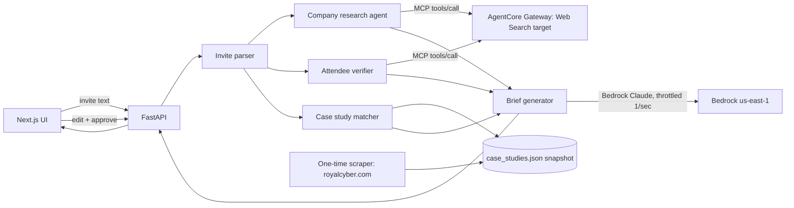

# Inside Sales Copilot — Architecture Document

**Organization:** Royal Cyber Inc.
**Program:** AWS AI-DLC Hackathon — Team 5
**Date:** November 20, 2026
**Region:** us-east-1
**Version:** 3.0 (aligned with `Inside-Sales-Copilot-Draft-Plan.md`)

---

## Table of Contents

1. [Executive Summary](#1-executive-summary)
2. [Problem Statement](#2-problem-statement)
3. [Solution Overview](#3-solution-overview)
4. [Architecture Diagram](#4-architecture-diagram)
5. [Component Details](#5-component-details)
6. [Royal Cyber BU Taxonomy & Case Studies](#6-royal-cyber-bu-taxonomy--case-studies)
7. [Discovery Brief Output Format](#7-discovery-brief-output-format)
8. [AWS Services Summary](#8-aws-services-summary)
9. [Cost & Rate Limit Controls](#9-cost--rate-limit-controls)
10. [Deployment Plan](#10-deployment-plan)
11. [Demo Script](#11-demo-script)
12. [Open Questions](#12-open-questions)
13. [Appendix A — Key URLs](#appendix-a--key-urls)

---

## 1. Executive Summary

Inside Sales Copilot turns a pasted meeting invite into a cited discovery brief in minutes. The SE pastes the invite. The copilot parses it, researches the prospect company from public web sources, checks each attendee without guessing, matches Royal Cyber case studies from a pre-scraped snapshot, and drafts a brief. The SE edits the brief inline and approves it. Approval locks the brief and unlocks the Markdown export.

Every fact carries a source URL, and a validator rejects any fact without one. The system is a fixed pipeline of typed steps behind a FastAPI backend with a Next.js UI. It is not a multi-agent system and has no database. Target: a working local demo in one day (8 hours).

| Metric | Before | After |
|---|---|---|
| Pre-call research time | Hours of manual research | Draft brief in under about 2 minutes (the "hours saved" figure comes from an SE interview, see Open Questions) |
| Facts with cited sources | Inconsistent | Every fact has a source URL (enforced by a validator) |
| Attendee identity | Can pick the wrong person | Verified only when employer and title match the invite, otherwise "unverified" |
| RC case study match | Memory-dependent | Top 3 from the snapshot, each with a reason |
| Brief consistency across SEs | Low | Standard format, SE edits and approves |

---

## 2. Problem Statement

Before every discovery call, Royal Cyber's presales staff (AEs, SEs, SAs) spend hours on manual research across browser tabs:

- Company size, industry, recent news and likely pain points
- Whether the attendee found online is the right person
- Which Royal Cyber case studies are relevant

The research is scattered, can pick the wrong person, and has no standard format or source tracking.

---

## 3. Solution Overview

**Input:** a pasted meeting invite for any public company, entered at runtime, plus an optional BU filter.

The copilot runs these steps:

1. **Parses the invite** into `Invite`, `Company` and `Attendee` (name, title, employer, email domain). Missing fields are null, never guessed. If the company is missing, it is inferred from attendee email domains.
2. **Researches the company** from public web sources: industry, size tier (enterprise, mid-market, SMB or boutique), recent news and pain-point hypotheses. Every fact is `{claim, source_url, source_title}`.
3. **Verifies attendees.** A profile counts as verified only if employer and title both match the invite. Otherwise the attendee is "unverified" with a reason (no match, conflicting employer). Search covers public information only.
4. **Matches case studies** from a pre-scraped snapshot of the public Royal Cyber site. The matcher shortlists by industry, technology and optional BU, then picks the top 3 with a one-line reason each.
5. **Generates the brief:** agenda, questions to ask, pain-point hypotheses and case studies to mention. The brief starts with status `draft`.
6. **SE edits and approves.** Edits are inline. Approval sets status `approved`, locks editing, and enables the Markdown export. Original and edited text are both kept so a later "learn from edits" feature has history.

**Out of scope (roadmap):** learning rules from SE edits, Outlook integration, case study management screens, full RBAC, RFP copilot.

---

## 4. Architecture Diagram



Design rules:

- **Fixed pipeline.** Each step returns typed Pydantic objects.
- **Source rule.** A validator rejects any fact with no source URL.
- **Throttle.** One wrapper around all Bedrock calls enforces 1 call per second.
- **PII masking.** A Bedrock Guardrail with PII filters (email and similar) wraps every Bedrock call, on input and output.
- **Storage.** Briefs are held in memory or a local JSON file. No database.

---

## 5. Component Details

### 5.1 Next.js UI

**Technology:** Next.js (`frontend/`)
**Runs:** locally for the hackathon

One page with:

- Paste box for the invite and an optional BU selector
- Progress indicator while the pipeline runs
- Rendered brief: company snapshot with size tier, attendees with verified/unverified badges, pain points, case studies, agenda and questions
- A clickable source link on every fact
- Inline editing of each section, an Approve button, and a Markdown export button (enabled after approval)

No authentication for the hackathon.

---

### 5.2 FastAPI Backend

**Technology:** Python, FastAPI, pytest (`backend/`)

| Endpoint | Purpose |
|---|---|
| `GET /health` | Health check |
| `POST /parse` | Invite text to company and attendee list |
| `GET /case-studies?bu=...` | Snapshot list with optional BU filter |
| `POST /research` | Company name to cited `CompanyProfile` |
| `POST /attendees/verify` | Status and source per attendee |
| `POST /briefs` | Runs the full pipeline, returns a `Brief` with status `draft` |
| `PATCH /briefs/{id}` | Edit sections (rejected once approved) |
| `POST /briefs/{id}/approve` | Sets status `approved` and locks editing |

`POST /briefs` runs research and attendee verification in parallel where the throttle allows. If one step fails, it returns partial results with that section flagged and a clear error.

---

### 5.3 Agent Layer

**Framework:** Strands Agents with Claude on Amazon Bedrock, us-east-1.
**Model ID:** set in configuration during Task 1 (not fixed in this document).

Each step is a Claude call with a strict JSON schema or a tool-using research call. All Bedrock calls go through the throttled, guardrailed wrapper.

---

### 5.4 Web Search (AgentCore Gateway)

**Service:** Amazon Bedrock AgentCore managed Web Search Tool, added as a Gateway target with `connectorId: "web-search"`.
**Docs:** https://docs.aws.amazon.com/bedrock-agentcore/latest/devguide/gateway-target-connector-web-search-tool.html

- Exposed as an MCP tool `WebSearch` with inputs `query` (200 characters or fewer) and `maxResults` (1 to 25).
- Connector version 1.2.0 and later adds per-call domain and published-date filters.
- Results include snippet text, URL, title and publication date.
- Available in us-east-1. Free monthly queries are shared across the account.
- Inbound auth is unverified. JWT is documented for Claude. IAM (SigV4) is probably simpler for our backend. Task 1 settles this.
- No per-second rate limit is documented for the tool, so we add our own throttle.

**Acceptable use terms that shape the design:**

- Keep and display source citations and links with every result used.
- Do not store results in bulk or build an index from them. This is why the case study snapshot comes from a direct scrape of royalcyber.com and not from this tool.

**Company research queries** (targeted; the news query uses a published-date filter):

| Query | Output |
|---|---|
| Company overview and size | Industry, size tier |
| Recent news | Recent headlines, date-filtered |
| Challenges | Pain-point hypotheses |

**Size tier rules** are stated explicitly in the prompt, by employee count and revenue. Starting proposal (employee thresholds, to be confirmed in Task 4):

| Tier | Employees |
|---|---|
| Enterprise | > 5,000 |
| Mid-market | 500 – 5,000 |
| SMB | 50 – 500 |
| Boutique | < 50 |

---

### 5.5 Attendee Verification

All attendee search logic sits in one function, so a guardrail can be added quickly if the mentor says real-person search conflicts with the one-pager's "test data only" line.

- Search by name and employer, public information only.
- `verified` only when a result shows both employer and title matching the invite. The matching source URL is stored.
- Otherwise `unverified` with a reason. Nothing is guessed.

---

### 5.6 Case Study Snapshot and Matcher

**Source:** a one-time scraper of the public Royal Cyber case study pages (direct scrape, not the search tool).
**Store:** `data/case_studies.json`, a local file. No S3, no Knowledge Base, no vector store.

**Record schema:**

```json
{
  "title": "IBM Z Encryption Modernization Cuts MSU 38%",
  "url": "https://www.royalcyber.com/resources/case-studies/ibm-z-encryption-modernization-msu-reduction/",
  "summary": "Royal Cyber reduced IBM Z software licensing costs by 38% through cryptographic offload...",
  "industry": "Financial Services",
  "technologies": ["IBM Z"],
  "bu": "IBM"
}
```

**Matching:**

1. A loader returns the snapshot, with an optional BU filter applied.
2. The matcher shortlists by industry and technology.
3. Claude picks the top 3 and writes a one-line reason each that refers to the company profile.
4. Only IDs present in the snapshot are allowed in the output. Exactly 3 are returned when at least 3 are available.

---

## 6. Royal Cyber BU Taxonomy & Case Studies

**The BU list is provisional.** It is decided after the Task 3 scrape and a review with Sravani. The BU filter is optional. The tables below are the starting candidates from the Royal Cyber site and will be replaced by the scraped data.

### Candidate Business Units

| BU | Royal Cyber Page | Key Solutions |
|---|---|---|
| ServiceNow | [royalcyber.com/…servicenow](https://www.royalcyber.com/technologies/servicenow-consulting-services/) | ITSM, ITOM, ITAM, GRC, HRSD |
| AWS | [royalcyber.com/…aws-transform](https://www.royalcyber.com/technologies/mainframe-applications-services/aws-transform-for-mainframe-modernization/) | Cloud migration, mainframe modernization |
| IBM | [royalcyber.com/…ibm-consulting](https://www.royalcyber.com/services/ibm-consulting/) | IBM Z, Cloud Pak, API Connect, IBM Cloud |
| Salesforce | [royalcyber.com/…salesforce](https://www.royalcyber.com/technologies/salesforce-consulting-services/) | Implementation, integration, Agentforce |
| Azure | [royalcyber.com/…azure](https://www.royalcyber.com/technologies/microsoft-azure/) | Cloud consulting, migration, managed services |
| GCP | [royalcyber.com/technologies](https://www.royalcyber.com/technologies/) | Infrastructure, cloud-native |
| Databricks | [royalcyber.com/…databricks](https://www.royalcyber.com/technologies/databricks-consulting-services/) | Data lakehouse, ML, GenAI |
| eCommerce | [royalcyber.com/services](https://www.royalcyber.com/services/) | SAP, BigCommerce, commercetools, Hybris |
| AI / GenAI | [royalcyber.com](https://www.royalcyber.com/) | Private AI, Bedrock solutions |

### Candidate Case Studies (expected in the snapshot)

| Title | BU | Industry | URL |
|---|---|---|---|
| Private AI Research Assistant | AI/GenAI | Research | https://www.royalcyber.com/resources/case-studies/private-ai-research-assistant/ |
| AWS Business Performance Solutions | AWS | Financial Services | https://www.royalcyber.com/resources/case-studies/aws-business-performance-solutions/ |
| IBM Z Encryption Modernization (38% MSU cut) | IBM | Financial Services | https://www.royalcyber.com/resources/case-studies/ibm-z-encryption-modernization-msu-reduction/ |
| Legacy European Bank Modernization | IBM / AWS | Banking | https://www.royalcyber.com/resources/case-studies/migrating-legacy-application-to-a-modernized-environment-for-a-leading-european-bank/ |
| commercetools for JSW One | eCommerce | Manufacturing | https://www.royalcyber.com/resources/case-studies/implementing-commercetools-for-jsw-one/ |
| SAP Hybris / Fletcher Building | eCommerce / SAP | Manufacturing | https://www.royalcyber.com/resources/case-studies/digital-transformation-using-sap-hybris-services/ |
| GCP Network Platform | GCP | Telecom | https://www.royalcyber.com/resources/case-studies/robust-infrastructure-platform-with-gcp/ |
| Credit Evaluation Microservices | AWS | Financial Services | https://www.royalcyber.com/resources/case-studies/streamlining-credit-evaluations-microservices/ |
| BigCommerce B2C — Mico | eCommerce | Distribution | https://www.royalcyber.com/resources/case-studies/enhancing-the-b2c-ecommerce-portal-for-mico/ |
| IBM API Connect — Modern API Platform | IBM | Enterprise IT | https://www.royalcyber.com/wp-content/uploads/2026/11/Modern-API-Platform-IBM-API-Connect-Case-Study.pdf |

---

## 7. Discovery Brief Output Format

The `Brief` object has a status (`draft` or `approved`), the sections below, and for each section both the original generated text and the SE-edited text. The Markdown export is available only after approval and includes every source link.

```markdown
## Discovery Brief — {company}
Prepared by Royal Cyber Inside Sales Copilot  |  {date}  |  Status: {draft / approved}

---

### Company Snapshot
- **Industry:** {industry}  |  **Size tier:** {size_tier}
- **Recent news:** "{headline}" ([source]({url}))

### Attendees
- {name}, {title}, {employer} — {verified ([source]({url})) / unverified: {reason}}

### Pain-Point Hypotheses
1. {pain_point} ([source]({url}))
2. {pain_point} ([source]({url}))
3. {pain_point} ([source]({url}))

---

### Case Studies to Mention
1. **{title}** ({bu} · {industry})
   {one-line reason referring to the company profile}
   [View on royalcyber.com]({url})
2. **{title}** ({bu} · {industry})
   {reason}
   [View on royalcyber.com]({url})
3. **{title}** ({bu} · {industry})
   {reason}
   [View on royalcyber.com]({url})

---

### Agenda
{generated from the earlier outputs}

### Questions to Ask
{generated from the earlier outputs}
```

If a pipeline step fails (for example search errors out), the brief is still returned with that section flagged.

---

## 8. AWS Services Summary

| Service | Role | Notes |
|---|---|---|
| Amazon Bedrock (Claude) | Parsing, research synthesis, case study matching, brief generation | us-east-1, throttled to 1 call per second |
| Bedrock Guardrails | Mask PII (email and similar) in model input and output | Created in Task 1. Decision from the team lead, to be confirmed with the mentor |
| Bedrock AgentCore Gateway | Hosts the Web Search target (`connectorId: "web-search"`) | us-east-1; IAM vs JWT inbound auth settled in Task 1 |
| AgentCore Web Search Tool | Company and attendee research with cited sources | Free monthly queries shared across the account. Post-free-tier pricing unconfirmed |
| Strands Agents | Agent framework in the backend | Library, not an AWS-hosted service |
| AWS CDK / CloudFormation | Infrastructure as code for all AWS resources | Stacks in `infra/`, see section 10 |

Non-AWS: FastAPI and Next.js run locally.

**Removed from v2.0:** Bedrock Agents, Bedrock Knowledge Base, Amazon S3 Vectors, Amazon S3 bucket, Scraper Lambda, Titan Embeddings, Streamlit, opportunity scoring and service recommendations.
**Removed from v1:** DynamoDB, EventBridge Scheduler, API Gateway, multi-agent supervisor, correction rules loop.
**Added in v3.0:** attendee verification, edit and approve flow, PII guardrail, local case study snapshot.

---

## 9. Cost & Rate Limit Controls

**Constraints:** us-east-1 only. No more than one Bedrock call per second.

**Throttle:** one wrapper around all Bedrock calls enforces the limit. A unit test checks that calls are spaced at least 1 second apart. The search tool has no documented rate limit, so research and attendee search calls get their own throttle.

**Bedrock calls per brief** (Claude calls, all through the wrapper):

| Step | Calls |
|---|---|
| Invite parse | 1 |
| Company research synthesis | 1 or more |
| Attendee verification | Depends on attendee count |
| Case study matcher | 1 |
| Brief generation | 1 |

The total varies with attendee count. Calls are serialized by the throttle, so a brief takes at least as many seconds as it has calls. The target is a full draft brief in under about 2 minutes.

**Cost:** not yet estimated. The v2.0 figures assumed 2 Bedrock calls and 4 searches and no longer apply. Post-free-tier web search pricing is an open research item, and the free monthly queries are shared across the account.

---

## 10. Deployment Plan

The demo runs locally. AWS deployment is a stretch goal (Task 10).

### Infrastructure as Code (AWS CDK)

All AWS resources are defined as AWS CDK stacks in an `infra/` folder, deployed to us-east-1 only. No resources are created by hand in the console.

| Stack | Resources | Needed for |
|---|---|---|
| `GuardrailStack` | Bedrock Guardrail with PII filters (email and similar) | Task 1 onward |
| `GatewayStack` | AgentCore Gateway with the `web-search` connector target, inbound auth (IAM or JWT) | Task 1 onward |
| `IamStack` | Execution role and policies for the backend: Bedrock invoke, Guardrail apply, Gateway invoke | Task 1 onward |
| `AppStack` (stretch) | Backend on AgentCore Runtime or a container service, UI on a static host | Task 10 stretch |

The stack split above is a proposal. Two points need confirming in Task 1:

- Whether the Gateway and its `web-search` connector target can be expressed with the installed CDK version (L2 or L1 constructs). If not, the Gateway is created with the AgentCore CLI and documented as the one manual step.
- The CDK language. The backend is Python, so Python CDK keeps one language. TypeScript CDK would match the Next.js UI.

The plan's Task 1 says the Gateway is created with the AgentCore CLI. With CDK as the IaC choice, that step becomes a CDK stack, subject to the first point above.

### Setup Checklist

- [ ] Create repo with `backend/` (FastAPI, pytest), `frontend/` (Next.js) and `infra/` (CDK)
- [ ] Bootstrap CDK in us-east-1 (`cdk bootstrap`)
- [ ] Deploy `GatewayStack`: AgentCore Gateway in us-east-1 with a `web-search` connector target
- [ ] Write a Python MCP client that calls `tools/list` and `tools/call`
- [ ] Deploy `GuardrailStack`: Bedrock Guardrail with PII filters
- [ ] Add the throttled, guardrailed Bedrock Claude wrapper
- [ ] Settle IAM (SigV4) vs JWT inbound auth
- [ ] Run the scraper once to produce `data/case_studies.json`, review with Sravani, fix the BU list
- [ ] Pre-run 2 or 3 candidate prospect companies for the cached fallback

### Runtime

| Component | Where |
|---|---|
| Next.js UI | Local |
| FastAPI backend | Local |
| Case study snapshot | Local file `data/case_studies.json` |
| Briefs | In memory or a local JSON file |
| Bedrock, Guardrails, AgentCore Gateway | AWS us-east-1 |

**Stretch:** backend on AgentCore Runtime or a container service, UI on a static host, both added as a CDK stack (`AppStack`).

### Implementation Tasks (from the plan)

| # | Task | Notes |
|---|---|---|
| 1 | Scaffold and AWS connectivity spike | Gateway, MCP client, throttle, guardrail, auth decision |
| 2 | Invite parser | `POST /parse` |
| 3 | Case study scraper and snapshot | `GET /case-studies` |
| 4 | Company research with citations | `POST /research` |
| 5 | Attendee verification | `POST /attendees/verify` |
| 6 | Case study matcher | Top 3 with reasons |
| 7 | Brief generator and pipeline | `POST /briefs` |
| 8 | UI: paste invite and view brief | Badges, citation links |
| 9 | Edit, approve and export | `PATCH`, `approve`, Markdown export |
| 10 | Demo hardening and optional AWS deployment | Cached fallback, rehearsal |

Time budget (8 hours): Task 1 (1h), Tasks 2 and 3 in parallel (1h), Tasks 4 to 6 (2.5h), Task 7 (1h), Tasks 8 and 9 (1.5h), Task 10 (1h).

---

## 11. Demo Script

The full demo flow is about 3 minutes, inside a 10-minute presentation. The prospect company is chosen at runtime, so nothing is hard-coded.

| Step | Action | What the audience sees |
|---|---|---|
| 1 | Paste a meeting invite for a public company chosen at runtime | Invite text in the input box |
| 2 | Leave the BU selector blank (or pick one) | Optional filter |
| 3 | Start the run | Progress indicator |
| 4 | Brief appears | Company snapshot with size tier and cited news |
| 5 | Show attendees | Verified badges, plus a deliberately wrong person flagged "unverified" |
| 6 | Show pain points and case studies | Each fact has a clickable source link. 3 case studies with reasons |
| 7 | Edit one line | Inline edit |
| 8 | Approve | Brief locks |
| 9 | Download Markdown | Export includes every citation |
| 10 | Wrap up | Hours of research reduced to minutes. Every fact cited. Every case study from royalcyber.com |

**Fallback:** a backup recording or the cached last run for that company if the network fails.

---

## 12. Open Questions

| # | Question | Owner | Needed By |
|---|---|---|---|
| 1 | Which prospect company to use for the demo (runtime input)? | Team | Kickoff |
| 2 | Does searching for real attendees conflict with the one-pager's "test data only" line? Mentor to confirm at kickoff | Sravani | Kickoff |
| 3 | Mentor to confirm the Bedrock Guardrails PII masking decision from the team lead | Tariq | Kickoff |
| 4 | Final BU list (decided after the Task 3 scrape) | Sravani | After Task 3 |
| 5 | IAM (SigV4) vs JWT inbound auth for the Gateway | Ubaid | Task 1 |
| 6 | Post-free-tier web search pricing | Team | Before demo |
| 7 | Strands MCP client setup, any AgentCore sample repo or Royal Cyber template, who knows the AgentCore CLI or the Royal Cyber site structure | Team | Task 1 |
| 8 | CDK language (Python or TypeScript), and whether the Gateway web-search target is supported by the installed CDK version | Ubaid | Task 1 |
| 9 | Real "hours saved per call" number from SE interview | Sravani | Before demo |

---

## Appendix A — Key URLs

| Resource | URL |
|---|---|
| Royal Cyber Website | https://www.royalcyber.com |
| Royal Cyber Case Studies | https://www.royalcyber.com/resources/case-studies/ |
| Royal Cyber ServiceNow | https://www.royalcyber.com/technologies/servicenow-consulting-services/ |
| Royal Cyber AWS | https://www.royalcyber.com/technologies/mainframe-applications-services/aws-transform-for-mainframe-modernization/ |
| Royal Cyber IBM | https://www.royalcyber.com/services/ibm-consulting/ |
| Royal Cyber Salesforce | https://www.royalcyber.com/technologies/salesforce-consulting-services/ |
| Royal Cyber Databricks | https://www.royalcyber.com/technologies/databricks-consulting-services/ |
| AgentCore Gateway Web Search target | https://docs.aws.amazon.com/bedrock-agentcore/latest/devguide/gateway-target-connector-web-search-tool.html |
| Bedrock AgentCore Web Search announcement | https://aws.amazon.com/about-aws/whats-new/2026/06/amazon-bedrock-agentcore-web-search/ |

---

*Document prepared by Team 5 · AWS AI-DLC Hackathon · Royal Cyber Inc.*
