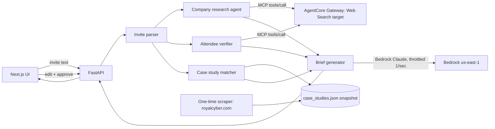

# Implementation Plan: Inside Sales Copilot

## Problem Statement
Presales staff (AEs, SEs, SAs) at Royal Cyber spend hours on manual research before each discovery call. The research is scattered across tabs, can pick the wrong person, and has no standard format. We will build a copilot that turns a pasted meeting invite into a cited discovery brief in minutes. The SE can edit and approve the brief. Target: a working local demo in one day (8 hours).

## Requirements
- Input: a pasted meeting invite for any public company, entered at runtime.
- Company research from public web sources: industry, size tier (enterprise, mid-market, SMB or boutique), recent news and likely pain points. Every fact carries a source URL.
- Attendee check: a profile counts as verified only if employer and title match the invite. Otherwise the attendee is marked "unverified" and nothing is guessed. Search covers public information only, with no extra guardrails.
- Case study matching from a pre-scraped snapshot of the public Royal Cyber site, tagged by BU, with a reason for each match. The BU list is decided after the scrape, and the BU filter is optional.
- Brief output: agenda, questions to ask, pain-point hypotheses and case studies to mention.
- The SE edits sections inline and approves. Approval locks the brief, and an export is available after approval.
- PII handling: use Amazon Bedrock Guardrails to mask PII, such as email addresses, in model input and output. Attendee search stays public-information only. (Decision from the team lead; to be confirmed with the mentor.)
- Constraints: us-east-1 only, no more than one Bedrock call per second. Runs locally, with AWS deployment as a stretch.
- Out of scope (roadmap): learning rules from SE edits, Outlook integration, case study management screens, full RBAC, RFP copilot.

## Background (research findings)
- AgentCore has a managed Web Search Tool, added as a Gateway target with `connectorId: "web-search"`. Docs: https://docs.aws.amazon.com/bedrock-agentcore/latest/devguide/gateway-target-connector-web-search-tool.html
  - Exposed as an MCP tool, `WebSearch`, with inputs `query` (200 characters or fewer) and `maxResults` (1 to 25).
  - Connector version 1.2.0 and later adds per-call domain and published-date filters.
  - Results include snippet text, URL, title and publication date.
  - Available in us-east-1. Free monthly queries are shared across the account.
- Acceptable use terms:
  - We must keep and display source citations and links with every result we use.
  - We may not store results in bulk or build an index from them.
  - The case study snapshot must therefore come from a direct scrape of royalcyber.com, not from the search tool.
- Auth is unverified. The docs show JWT inbound auth for Claude. For our own backend, IAM (SigV4) inbound auth is probably simpler. Task 1 will confirm which works.
- The docs did not confirm a per-second rate limit on the search tool, so we add our own throttle.
- Risk: attendee search for real people may conflict with the one-pager's "test data only" line. A mentor is confirming this at kickoff. Keep attendee search behind one function so a guardrail can be added quickly.

## Proposed Solution

- Stack: Python and FastAPI backend, Strands Agents with Bedrock Claude, Next.js UI. No backend exists in the repo yet; Task 1 introduces it.
- PII masking: a Bedrock Guardrail with PII filters (email and similar) wraps every Bedrock call. Task 1 creates it and Task 2 onward relies on it.
- Pipeline: fixed steps, each returning typed Pydantic objects.
- Source rule: a validator rejects any fact that has no source URL.
- Throttle: one wrapper around all Bedrock calls enforces 1 call per second.
- Storage: briefs held in memory or a local JSON file. No database.

## Suggested owners (from team.md; adjust as needed)
| Stream | Owner |
|---|---|
| Use case, approval gates, demo | Tariq |
| Agent and prompt design review (Tasks 4-7) | Jason, Naveen |
| Backend, Gateway and agent (Tasks 1, 2, 4-7) | Ubaid, with Dhiraj pairing |
| UI and approve flow (Tasks 8-9) | Moazzam |
| Scraper and case study data (Task 3) | Moazzam or Dhiraj, with Sravani on BU tags |
| Acceptance criteria, test invites, QA | Srinivasa |
| Customer view, call-prep time figure, demo prospect | Sravani |

## Task Breakdown

- [ ] **Task 1: Project scaffold and AWS connectivity spike**
  - Objective: prove the two external dependencies work before building on them.
  - Guidance: create a repo with `backend/` (FastAPI, pytest) and `frontend/` (Next.js). Use the AgentCore CLI to create a Gateway in us-east-1 with a `web-search` connector target. Write a small Python MCP client that calls `tools/list` and `tools/call`. Add the throttled Bedrock Claude wrapper (1 call per second). Settle IAM vs JWT inbound auth here.
  - Tests: a `/health` endpoint test, a unit test of the throttle (calls spaced at least 1 second apart), and an integration test marked `live` for search and Bedrock.
  - Demo: a CLI command takes a company name and prints search results with titles and URLs, plus one Claude reply.

- [ ] **Task 2: Invite parser**
  - Objective: turn pasted invite text into structured data.
  - Guidance: define Pydantic models `Invite`, `Company` and `Attendee` (name, title, employer, email domain). Use a Claude call with a strict JSON schema. Include a fallback that infers the company from attendee email domains. Mark missing fields as null rather than guessing.
  - Tests: 4 to 5 sample invites (clean, messy, missing titles, multiple companies) with expected outputs, written by Srinivasa.
  - Demo: `POST /parse` returns the company and attendee list for a pasted invite.

- [ ] **Task 3: Case study scraper and snapshot**
  - Objective: build the local case study library.
  - Guidance: scrape the public Royal Cyber case study pages directly (not through the search tool). Save the title, URL, summary, industry, technologies and a BU tag to `data/case_studies.json`. Review the data with Sravani, then fix the BU list. Add a loader that supports an optional BU filter.
  - Tests: schema validation of every record, the BU filter returns only matching records, and a count check.
  - Demo: `GET /case-studies?bu=...` returns the filtered list.

- [ ] **Task 4: Company research with citations**
  - Objective: produce a cited company profile.
  - Guidance: run targeted queries (overview and size, recent news, challenges), with a published-date filter on the news query. Use Claude to build a `CompanyProfile` with industry, size tier, news items and pain-point hypotheses. Each fact is `{claim, source_url, source_title}`. The validator drops any claim with no source. Define the size tier rules explicitly in the prompt (for example by employee count and revenue).
  - Tests: the validator rejects an uncited fact, recorded search fixtures give stable output, and the size tier mapping is checked on boundary cases.
  - Demo: `POST /research` with a company name returns a profile where every fact has a link.

- [ ] **Task 5: Attendee verification**
  - Objective: verify attendees without guessing.
  - Guidance: search for each attendee by name and employer. Mark `verified` only when a result shows both employer and title matching the invite, and store the matching source URL. Otherwise mark `unverified` with a reason (no match, conflicting employer). Keep all search logic in one function so a guardrail can be added later.
  - Tests: fixtures for a match, a wrong-company namesake, a wrong title and no results. Only the first may be verified.
  - Demo: `POST /attendees/verify` returns a status and a source per person, with a deliberately wrong person flagged "unverified".

- [ ] **Task 6: Case study matcher**
  - Objective: pick relevant case studies and say why.
  - Guidance: shortlist from the snapshot by industry, technology and optional BU, then have Claude pick the top 3 and write a one-line reason for each that refers to the company profile. Only IDs from the snapshot are allowed in the output.
  - Tests: output IDs exist in the snapshot, the BU filter is honoured, and exactly 3 results come back when at least 3 are available.
  - Demo: given a company profile, the API returns 3 matched case studies with reasons.

- [ ] **Task 7: Brief generator and end-to-end pipeline**
  - Objective: wire Tasks 2 to 6 into one call.
  - Guidance: generate the agenda, questions to ask, pain-point hypotheses and case studies to mention from the earlier outputs. Expose `POST /briefs`, which runs the full pipeline and returns a `Brief` with status `draft`. Run research and attendee verification in parallel where the throttle allows. Return partial results with a clear error if one step fails.
  - Tests: an end-to-end test on recorded fixtures, a check that every fact in the brief has a source, and a failure test where search errors out and the brief is still returned with that section flagged.
  - Demo: `curl` with an invite returns a full draft brief in under about 2 minutes.

- [ ] **Task 8: UI to paste an invite and view the brief**
  - Objective: give the SE a working screen.
  - Guidance: build a Next.js page with a paste box, an optional BU selector, a progress indicator and a rendered brief. Sections: company snapshot with size tier, attendees with verified/unverified badges, pain points, case studies, agenda and questions. Every fact shows a clickable source link.
  - Tests: component tests for the badges and citation links, plus one Playwright smoke test against the mocked API.
  - Demo: paste an invite in the browser and see the brief with cited facts and flagged attendees.

- [ ] **Task 9: Edit, approve and export**
  - Objective: complete the SE workflow.
  - Guidance: make each section editable inline. Add `PATCH /briefs/{id}` for edits and `POST /briefs/{id}/approve`, which sets status `approved` and locks editing. Add a Markdown export that includes source links, available only after approval. Keep the original and edited text so edit history exists for a later "learn from edits" feature.
  - Tests: an edit persists, an approved brief rejects further edits, and the export contains every citation.
  - Demo: edit one line, approve, and download the Markdown. This is the full 3-minute demo flow.

- [ ] **Task 10: Demo hardening and optional AWS deployment**
  - Objective: make the demo reliable.
  - Guidance: cache the last successful run per company as a fallback, add clear loading and error states, and write the demo script with Tariq. Pre-run two or three candidate prospect companies. Rehearse the 10-minute presentation. Stretch: deploy the backend to AgentCore Runtime or a container service, and the UI to a static host.
  - Tests: a rehearsal checklist from Srinivasa, plus a run against 3 different companies to confirm nothing is hard-coded.
  - Demo: the full live flow on a runtime-chosen company, with a backup recording or cached run if the network fails.

**Suggested time budget (8 hours):** Task 1 (1h), Tasks 2 and 3 in parallel (1h), Tasks 4 to 6 (2.5h), Task 7 (1h), Tasks 8 and 9 (1.5h), Task 10 (1h).

## Open items

- Research input from the team: Strands MCP client setup, post-free-tier web search pricing, any AgentCore sample repo or Royal Cyber template, and who knows the AgentCore CLI or the Royal Cyber site structure.
- The mentor's answer on real-attendee search.
- The demo prospect company (runtime input).
- The BU list (decided after Task 3).
