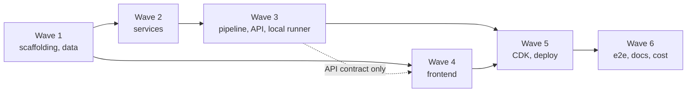

# Tasks: Inside Sales Copilot

Status: **draft for review**.
Inputs: `requirements.md` and `design.md` (both approved). Requirement ids (R1 to R10) and design sections (D§) refer to those files.

## Priorities and build order

Every task is tagged **[MVP]** or **[STRETCH]**. Time limit: Sunday 9:00, with limited Kiro credits.

1. Build all **[MVP]** tasks first, across all waves, in wave order (wave gates still apply, see below).
2. Only then come back for the **[STRETCH]** tasks, on a `feature/stretch` branch, ending with gate S.1.

[MVP] is everything on the demo path: sign in, paste, parse preview and confirm, progress, brief view and edit, approve with rules review, BU separation (BU badge in the header, two users), CDK deploy, seed users, smoke test, end-to-end test, README, cost estimate, and demo script.

Where a [STRETCH] item is a test script for a document, the document itself stays [MVP] and its [MVP] test is a short manual checklist in the task.

Requirements partly deferred by [STRETCH] tasks: R8 (history page, API stays), R7.14 (saved rules page, API stays), R10.16 metrics `ResearchLatencyMs` and `BriefFailed`, and the pre-demo SQS throttling spike and rate-from-logs check (R10.1 is still enforced in code and tested in 2.1 and 2.2).

## How to read this file

- Six waves. A wave ends with a **gate task** that needs your approval before the wave branch is merged.
- Each task is small, names the files it touches, and has a test. A task is done when its test passes and it is committed (one commit per task) on `feature/wave-<n>`.
- **[P]** marks tasks that can run in parallel with other [P] tasks in the same group. Tasks without [P] run in order. "Needs" lists the tasks that must be finished first.
- All backend tests run in `backend/.venv` (Python 3.12): `backend/.venv/bin/python -m pytest backend/tests`.
- Bedrock is never called in tests. Tests use a fake client and recorded fixtures.
- Git rules: local only, `feature/wave-<n>`, merge to `main` only after your approval, then `git bundle create /workshop/backups/inside-sales-copilot-wave-<n>.bundle --all`.

## Dependency overview

Wave 4 can start as soon as Wave 1 is done, because the frontend is built against the API contract (D§6) with a mock server. Waves 2 and 4 can run in parallel.

---

## Wave 1: scaffolding and data

Branch: `feature/wave-1`

- [x] **1.1 [MVP] Backend scaffold and `.gitignore`**
  - Files: `.gitignore`, `backend/pyproject.toml`, `backend/src/__init__.py`, `backend/src/{handlers,services,lib}/__init__.py`, `backend/tests/conftest.py`, `backend/tests/test_scaffold.py`
  - Do: ignore `backend/.venv`, `__pycache__`, `node_modules`, `cdk.out`, `dist`, `.env*`, `*.bundle`. Declare Python 3.12 and dev dependencies (pytest, moto, jsonschema, aws-lambda-powertools, boto3). No pydantic, to keep the Lambda package small and pure Python.
  - Test: `test_scaffold.py` checks `sys.version_info[:2] == (3, 12)` and that `backend.src.lib`, `services` and `handlers` import.
  - Needs: none. Requirements: R10.10, steering `structure.md`.

- [x] **1.2 [MVP] Infra scaffold with pinned region** [P]
  - Files: `infra/package.json`, `infra/tsconfig.json`, `infra/cdk.json`, `infra/bin/app.ts`, `infra/lib/{auth,data,api,web}-stack.ts` (empty stacks), `infra/test/app.test.ts`
  - Do: CDK v2 app with `AuthStack`, `DataStack`, `ApiStack`, `WebStack`. `env: { account: process.env.CDK_DEFAULT_ACCOUNT, region: 'us-east-1' }`. Context defaults `haikuModelId` and `sonnetModelId` in `cdk.json` (D§9.4).
  - Test (Jest): every stack's region is `us-east-1`; `cdk.json` model IDs equal the tested IDs.
  - Needs: none. Requirements: R10.10, R10.25.

- [x] **1.3 [MVP] Frontend scaffold** [P]
  - Files: `frontend/` (Vite + React + TypeScript + Tailwind), `frontend/src/App.tsx`, `frontend/src/App.test.tsx`, `frontend/vitest.config.ts`
  - Do: standard Vite template, Tailwind, Vitest with Testing Library, `aws-amplify`. No starter content.
  - Test (Vitest): `App` renders without crashing and shows the app title.
  - Needs: none. Requirements: none (structure).

- [x] **1.4 [MVP] Case study seed from the real CSV**
  - Files: `data/royal_cyber_case_studies.csv` (27 real entries, provided by the team), `data/case_studies.json` (generated), `scripts/import_case_studies.py`, `backend/tests/test_case_studies_seed.py`
  - Do: run `scripts/import_case_studies.py data/royal_cyber_case_studies.csv` to write `data/case_studies.json`. The JSON holds only the real entries: no placeholders. The placeholder logic and `DEMO_MODE` are removed from the importer and tests. The importer keeps its schema validation (BU names, https royalcyber.com URL, summary length, tags, no duplicate id or URL).
  - Test: the generated JSON has 27 valid entries; at least 5 entries each for AWS and ServiceNow; every URL starts with `https://royalcyber.com` or `https://www.royalcyber.com`; importer tests for bad BU, bad URL, wrong header, wrong column count, and stable ids when rows are reordered.
  - Needs: the CSV file. Requirements: R5.12, R5.13, R5.14.
  - Note for README (task 6.2): the seed comes from the public site through the team, because the site blocks automated fetching.

- [x] **1.5 [MVP] Attendee profile directory** (REMOVED Nov 20 with attendee verification) [P]
  - Files: `data/attendee_profiles.json`, `backend/src/lib/profiles.py`, `backend/tests/test_profiles.py`
  - Do: synthetic profiles keyed by lowercase email: `name`, `employer`, `employer_domain`, `title`, `source_url = "synthetic://profiles"`. Loader validates the schema and rejects duplicate emails.
  - Test: schema valid; every `source_url` is `synthetic://profiles`; duplicate email is rejected; lookup is case-insensitive.
  - Needs: none. Requirements: R4.1, R4.11.

- [x] **1.6 [MVP] Three sample invites and expected results**
  - Files: `data/sample_invites/{01,02,03}-*.txt`, `data/sample_invites/expected.json`, extra entries in `data/attendee_profiles.json`, `backend/tests/test_sample_invites.py`
  - Do: three invites for real public companies with fictional attendees. Together they cover: a verified attendee, an unverified attendee for title mismatch, an unverified attendee for no profile, a free-mail attendee, a duplicate email, and one invite with no meeting date. `expected.json` lists the expected attendee status and reason, used by tasks 2.4 and 2.5.
  - Test: each invite is 1 to 10,000 characters; `expected.json` covers all three cases (R4.13); every attendee email in the invites is either in the profile file or listed as "no profile".
  - Needs: 1.5. Requirements: R4.13, R2.

- [x] **1.7 [MVP] Shared models and constants** [P]
  - Files: `backend/src/lib/models.py`, `backend/src/lib/constants.py`, `backend/tests/test_models.py`
  - Do: dataclasses and JSON schemas for the objects in D§5 (parsed invite, research result, attendee check, case study match, brief content, brief view). Constants: statuses, steps, free-mail domain list, title abbreviation table, tier thresholds.
  - Test: sample objects validate against the schemas; invalid shapes are rejected; status and step names match the design.
  - Needs: 1.1. Requirements: D§5.

- [ ] **1.9 [MVP] Wave 1 gate**
  - Do: run all backend, frontend, and infra tests. Show `git diff main...feature/wave-1` for your review.
  - After your approval: merge to `main`, create `inside-sales-copilot-wave-1.bundle`.
  - Test: all three test suites green.

---

## Wave 2: backend building blocks

Branch: `feature/wave-2` (from `main` after Wave 1). Each task is a service or library with no AWS event handling.

**Parallel groups** (tasks in the same group can run at the same time):
- Group A: 2.1, then 2.2, then 2.4.
- Group B: 2.3, then 2.6, then 2.8 (2.8 also needs 2.2 and 2.7).
- Group C: 2.5 and 2.7 start immediately (they only need Wave 1). 2.9 and 2.10 start once 2.2 is done.
- Groups A, B and C run in parallel with each other.

- [x] **2.1 [MVP] Token bucket** [P, group A]
  - Files: `backend/src/lib/rate_limiter.py`, `backend/tests/test_rate_limiter.py`
  - Do: D§9.2. Capacity 1, 1 token per second, starts empty, injectable clock and sleep.
  - Test: with a fake clock, 20 consecutive `acquire()` calls start at least 1.0 s apart; first call waits 1 s; no call is allowed after a long idle time to burst more than 1 token.
  - Needs: 1.1. Requirements: R10.1, R10.2.

- [x] **2.2 [MVP] Bedrock client** (group A)
  - Files: `backend/src/lib/bedrock_client.py`, `backend/tests/test_bedrock_client.py`
  - Do: D§9. `converse_json(model, system, user, max_tokens, schema)`. `max_tokens` is required. Every attempt takes a token. Retry on throttling-type errors with exponential backoff and full jitter, 4 attempts. JSON schema validation with one repair retry. Metrics sink interface (`BedrockCalls`, `BedrockThrottled`). Model IDs from `BEDROCK_MODEL_HAIKU` and `BEDROCK_MODEL_SONNET`.
  - Test (stubbed boto3 client, fake clock): throttle then success (retries, 2 attempts counted); throttle 4 times raises `BedrockUnavailable`; `ValidationException` is not retried; invalid JSON then valid JSON succeeds with one repair; invalid twice raises `InvalidModelOutput`; every call sets `maxTokens`; 20 calls including retries never start less than 1 s apart; a repo-wide test fails if any other module under `backend/src` imports the Bedrock runtime client.
  - Needs: 2.1, 1.7. Requirements: R10.2, R10.5 to R10.9.

- [x] **2.3 [MVP] Safe HTTP fetch** [P, group B]
  - Files: `backend/src/lib/http_fetch.py`, `backend/tests/test_http_fetch.py`
  - Do: D§8.1 fetch rules. http/https only; resolve host and refuse private, loopback and link-local addresses, also after redirects; 8 s timeout; 500 KB cap; 3 redirects max; honest `User-Agent`; HTML to text.
  - Test (local test server and a stubbed resolver): `file://` and `ftp://` refused; `127.0.0.1`, `10.x`, `169.254.169.254` refused; redirect to a private address refused; oversized body cut off; timeout returns a failure; HTML tags, scripts and styles removed; 403 returns a failure, not an exception.
  - Needs: 1.1. Requirements: R3.16, R3.17.

- [x] **2.4 [MVP] Invite parser** (needs 2.2)
  - Files: `backend/src/services/invite_parser.py`, `backend/tests/test_invite_parser.py`
  - Do: P1 prompt and schema (D§10). Post-processing: lowercase emails, merge duplicates, add warnings (`only_free_email_domains`, `company_domain_mismatch`). A separate `validate_confirmation(parsed, company_confirmed)` implements R2.7 to R2.12 (company or non-free domain required, mismatch needs confirmation, max 20 attendees).
  - Test (fake Bedrock returning canned JSON for the three sample invites): fields extracted; missing fields stay `null`; duplicate emails merged; free-mail-only invite flagged; 21 attendees rejected on confirm; mismatch rejected until confirmed; injected instruction text in the invite does not change the output shape (the fake receives it inside `<invite>` tags).
  - Needs: 2.2, 1.6, 1.7. Requirements: R2.4 to R2.14.

- [x] **2.5 [MVP] Attendee verifier** (REMOVED Nov 20 by product owner decision) [P, group C]
  - Files: `backend/src/services/attendee_verifier.py`, `backend/tests/test_attendee_verifier.py`
  - Do: D§8.4, deterministic, no Bedrock.
  - Test: results match `data/sample_invites/expected.json`; each reason (`employer_mismatch`, `title_mismatch`, `no_profile_found`, `title_missing`, `ambiguous`); "VP Sales" equals "Vice President, Sales"; "Sr. Engineer" equals "Senior Engineer"; different titles never match; employer matches by name or by domain; no field is ever invented (profile is `null` when none).
  - Needs: 1.5, 1.6, 1.7. Requirements: R4.1 to R4.12.

- [x] **2.6 [MVP] Research providers and fixtures** (group B)
  - Files: `backend/src/services/research_provider.py` (the `ResearchProvider` interface and `PublicWebProvider`), `scripts/record_fixtures.py`, `backend/tests/fixtures/<company>/*`, `backend/tests/test_research_provider.py`
  - Do: D§8.1. Wikipedia REST (summary, page), company home and about page, Google News RSS (send locale parameters, follow redirects, newest 3). Fixture recorder fetches the live pages once for the sample invite companies and saves trimmed copies. A `FixtureProvider` reads them for tests and the local runner.
  - Test (fixtures, no network): documents carry `sourceUrl` and `kind`; news is limited to 3 and sorted newest first; one failing source does not stop the others; all sources failing returns an empty result; Wikipedia candidate is chosen by matching the domain, otherwise `unverified_match`.
  - Needs: 2.3, 1.6. Requirements: R3.1, R3.9, R3.13, R3.15.

- [x] **2.7 [MVP] Size tier** [P, group C]
  - Files: `backend/src/services/size_tier.py`, `backend/tests/test_size_tier.py`
  - Do: D§8.3.
  - Test (table of cases): 5,001 employees is Enterprise; 5,000 is Mid-market; 500 is Mid-market; 499 is SMB; 50 is SMB; 49 is Boutique; revenue $1.01B with 100 employees is Enterprise; revenue $1B exactly does not trigger Enterprise; employees unknown and revenue below $1B is Unknown; both unknown is Unknown; the rule text and basis are returned.
  - Needs: 1.7. Requirements: R3.5 to R3.8.

- [x] **2.8 [MVP] Research service** (needs 2.2, 2.6, 2.7)
  - Files: `backend/src/services/research.py`, `backend/tests/test_research.py`
  - Do: cache read and write (ResearchCache table, 7 days, `retrievedAt` check), P2 extraction, source integrity check (D§8.2), size tier from extracted numbers, news from RSS entries, "unknown" handling, `NO_PUBLIC_INFO` error.
  - Test (moto DynamoDB, fake Bedrock, fixture provider): every fact has at least one URL; a URL the provider did not fetch is removed; a fact left with no URL is dropped; a pain point whose facts were dropped is dropped; second call within 7 days makes no provider or Bedrock call; entry older than 7 days is refreshed; all sources empty raises `NO_PUBLIC_INFO`; model output claiming `employees` without a fact is rejected.
  - Needs: 2.2, 2.6, 2.7. Requirements: R3.2 to R3.14.

- [x] **2.9 [MVP] Case study matcher** [P, group C after 2.2]
  - Files: `backend/src/services/case_study_matcher.py`, `backend/tests/test_case_study_matcher.py`
  - Do: D§8.5 and P3. BU is a function argument supplied by the caller from the stored brief. Prefilter by BU, then industry and tags, top 8. Keep scores of 60 or more, top 3. Messages for fewer than 3 and for none. Title and URL always come from the JSON file.
  - Test (fake Bedrock): candidates never include another BU; a score of 59 is dropped and 60 is kept; sorted by score; 2 qualifying results carry "No strong match for <need>"; none qualifying gives "No strong match in your BU's library"; an id the model invented is ignored; a user with no BU gets no case studies.
  - Needs: 2.2, 1.4, 1.7. Requirements: R5.1 to R5.12.

- [x] **2.10 [MVP] Rules service** [P, group C; the extraction part needs 2.2]
  - Files: `backend/src/services/rules.py`, `backend/tests/test_rules.py`
  - Do: Rules table access: list newest 10, add with duplicate check on `textKey`, delete, all scoped to `userId`. `extract_rules(draft, final, existing)` with P5; skips the call when draft equals final.
  - Test (moto, fake Bedrock): user A cannot see or delete user B's rules; the 11th rule is not returned in the newest 10; same text with different case or spacing is not saved twice; identical draft and final makes no Bedrock call and returns none; more than 3 proposals are cut to 3; proposals equal to saved rules are removed.
  - Needs: 2.2, 1.7. Requirements: R7.6 to R7.15, R6.6.

- [ ] **2.11 [MVP] Wave 2 gate**
  - Do: run the full backend suite and show the diff. After your approval: merge, create `inside-sales-copilot-wave-2.bundle`.

---

## Wave 3: pipeline, API, local runner

Branch: `feature/wave-3`.

**Parallel groups:**
- Group D: 3.1 and 3.2 (no dependency on each other), then 3.3 and 3.6.
- Group E (after 3.6): 3.7, 3.8, 3.9 run in parallel.
- Group F (after 3.4): 3.5 and 3.10 run in parallel.

- [x] **3.1 [MVP] Brief store** [P, group D]
  - Files: `backend/src/lib/brief_store.py`, `backend/tests/test_brief_store.py`
  - Do: Briefs table access from D§5.1: create, conditional status transitions (jobId and expected status), `queueKey` set only while `queued`, `queuePosition`, history query by user with pages of 20, TTL `expiresAt` = created + 30 days, owner-checked get that returns "not found" for other users, stuck check (120 s).
  - Test (moto): a transition with a stale `jobId` fails; a duplicate delivery does not overwrite a newer status; queue position counts earlier queued briefs only; another user's brief returns not found; a `processing` brief older than 120 s becomes `failed` with `STUCK` and a `queued` brief does not; `expiresAt` is 30 days after creation; 25 briefs paginate 20 + 5 newest first.
  - Needs: 1.7. Requirements: R7.16, R8, R9.8, R9.9, R9.13.

- [x] **3.2 [MVP] Observability helpers** [P, group D]
  - Files: `backend/src/lib/observability.py`, `backend/tests/test_observability.py`
  - Do: Powertools logger with a redaction filter, metrics helper for `BriefGenerated`, `BedrockCalls`, and `BedrockThrottled` only; a Powertools implementation of the Bedrock client's metrics sink.
  - Test: a log line containing an email or the invite text is redacted; every log line carries `briefId`; the three metric names match the design.
  - Needs: 1.1, 2.2. Requirements: R10.13 to R10.15, part of R10.16.

- [ ] **3.2b [STRETCH] Remaining metrics**
  - Files: `backend/src/lib/observability.py`, `backend/src/services/pipeline.py`, `backend/tests/test_observability_extra.py`
  - Do: add `ResearchLatencyMs` (research step, cache hits excluded) and `BriefFailed` (dimension `step`), and show them on the dashboard.
  - Test: a cache miss emits `ResearchLatencyMs`, a cache hit does not; a failed step emits `BriefFailed` with the step.
  - Needs: 3.2, 3.4. Requirements: R10.16.

- [x] **3.3 [MVP] Brief writer** (needs 2.5, 2.9, 2.10)
  - Files: `backend/src/services/brief_writer.py`, `backend/tests/test_brief_writer.py`
  - Do: P4 with the 7 sections in fixed order. Code fills `attendees`, `caseStudies`, `sources`. Validation: agenda adds up to 30, 8 to 10 questions, every URL was fetched, every `basedOnFactIds` exists, ids assigned by code, rules applied listed.
  - Test (fake Bedrock): section order; agenda totals 29 triggers the repair retry; second failure raises; 7 questions rejected; an unknown URL removed or rejected; unverified attendee shown flagged and its title not used in other sections; unknown inputs say "unknown"; the 10 newest rules are sent and listed in `rulesApplied`.
  - Needs: 2.2, 2.5, 2.9, 2.10, 1.7. Requirements: R6.

- [x] **3.4 [MVP] Worker: parse job and pipeline job**
  - Files: `backend/src/handlers/worker.py`, `backend/src/services/pipeline.py`, `backend/tests/test_worker_pipeline.py`
  - Do: D§7.1. `parse` job: Parsing, then `awaiting_confirmation`. `pipeline` job: Researching, Checking attendees, Matching case studies, Writing brief, then `ready`. Records step before and after each step, skips steps in `stepsCompleted`, ignores stale `jobId`, marks `failed` with a code and step on handled errors, re-raises on crash.
  - Test (moto, fake Bedrock, fixture provider): happy path from `queued` to `ready` with steps in order; redelivered message does not run steps twice; stale job ignored; each handled error gives the code in D§11; retry after failure reuses finished steps and cached research; an unhandled crash re-raises; the BU used is the one stored on the brief.
  - Needs: 3.1, 2.4, 2.5, 2.8, 2.9, 3.3. Requirements: R9, R2.6, R3, R4, R5, R6.

- [x] **3.5 [MVP] Worker: rule extraction job** [P, group E]
  - Files: `backend/src/handlers/worker.py` (add the job type), `backend/tests/test_worker_rules.py`
  - Do: `extract_rules` job after approve: sets `rulesStatus` to `ready`, `none`, or `failed`; brief stays `approved` on failure.
  - Test: edited draft produces up to 3 proposals; identical text sets `none` with no Bedrock call; Bedrock failure sets `failed` and the brief stays `approved`.
  - Needs: 3.4, 2.10. Requirements: R7.6 to R7.13.

- [x] **3.6 [MVP] API common layer** [P, group E]
  - Files: `backend/src/lib/api.py`, `backend/tests/test_api_common.py`
  - Do: claims extraction (`sub`, `custom:bu`) from the authorizer context, JSON body parsing with size cap, error body `{error:{code,message}}`, standard 400, 404, 409 responses, no stack traces, UUID and ULID path validation, SQS send helper.
  - Test: body or query `userId` and `bu` are ignored; missing claims give 401; oversized body gives 400; an unexpected exception returns a generic 500 body without a traceback.
  - Needs: 3.1. Requirements: R1.9, R10.20.

- [x] **3.7 [MVP] Handlers: create, get, list** (needs 3.6)
  - Files: `backend/src/handlers/{create_brief,get_brief,list_briefs}.py`, `backend/tests/test_handlers_read_create.py`
  - Test (moto SQS and DynamoDB): empty, whitespace and 10,001-character text give 400 and nothing is queued; valid text gives 202, a `queued` brief and one message; `get` returns the brief view with `queuePosition`; another user gets 404; stuck brief returns `failed`; `list` returns only the caller's briefs, newest first, 20 per page.
  - Needs: 3.6. Requirements: R2.1 to R2.3, R8, R9.

- [x] **3.8 [MVP] Handlers: confirm, update, approve, retry** (group F, needs 3.6)
  - Files: `backend/src/handlers/{confirm_brief,update_brief,approve_brief,retry_brief}.py`, `backend/tests/test_handlers_write.py`
  - Test: confirm without company or domain gives 400 `COMPANY_REQUIRED`; mismatch without `companyConfirmed` gives 400; 21 attendees gives 400; confirm in the wrong status gives 409; `PUT` edits only in `ready` and keeps the draft unchanged; agenda minutes must still sum to 30; approve sets `approved`, queues one rules job, calls no Bedrock; second approve gives 409; retry only from `failed`; another user's brief gives 404 on every route.
  - Needs: 3.6, 2.4. Requirements: R2.6 to R2.12, R7.1 to R7.5, R7.16, R9.10, R9.11.

- [x] **3.9 [MVP] Handlers: rules and case studies** [P, group E]
  - Files: `backend/src/handlers/{rules,list_case_studies}.py`, `backend/tests/test_handlers_rules_cases.py`
  - Test: keep or discard saves only kept proposals; duplicate not saved twice; list and delete are scoped to the caller; `GET /case-studies` returns only the caller's BU and ignores a `bu` query parameter; a user with no `custom:bu` gets 403 `NO_BU`; two users with different BUs get different lists.
  - Needs: 3.6, 2.10. Requirements: R5.2, R5.3, R5.10, R5.11, R7.10 to R7.15.

- [x] **3.10 [MVP] Local runner**
  - Files: `backend/local_run.py` (module `backend.local_run`), `backend/tests/test_local_run.py`
  - Do: D§13.4. `python -m backend.local_run data/sample_invites/<file>.txt --bu AWS [--fake-bedrock] [--fixtures]`. Runs the worker job handlers directly against an in-memory store, auto-confirms the parse, prints the brief sections and attendee statuses.
  - Test: with `--fake-bedrock --fixtures`, each sample invite finishes `ready`, prints the 7 sections, shows the expected attendee statuses, and `--bu ServiceNow` prints different case studies from `--bu AWS`.
  - Needs: 3.4. Requirements: demo flow, R6.

- [ ] **3.11 [MVP] Wave 3 gate**
  - Do: full backend suite; run the local runner on all three sample invites with real Bedrock once each (about 12 calls, within the 1 rps limit) and show you the output; show the diff. After your approval: merge, create `inside-sales-copilot-wave-3.bundle`.

---

## Wave 4: frontend

Branch: `feature/wave-4`. Can start after Wave 1 and run in parallel with Waves 2 and 3. Built against the API contract (D§6) with a mock server (MSW), so it does not wait for the backend.

**Parallel groups:**
- Group G: 4.2, 4.3, 4.4, 4.5, 4.6 (after 4.1).
- Group H (after 4.5 and 4.6): 4.7, 4.8, 4.9.

- [x] **4.1 [MVP] API client, types, and mock server**
  - Files: `frontend/src/api/{client,types}.ts`, `frontend/src/mocks/{handlers,server}.ts`, `frontend/src/api/client.test.ts`
  - Do: typed client for all 11 routes; sends the ID token as bearer; maps the error body; on 401 signals sign-out. MSW handlers simulate every status and a queue.
  - Test: sends `Authorization` header; 401 triggers the sign-out callback; error body becomes a typed error.
  - Needs: 1.3. Requirements: D§6.

- [x] **4.2 [MVP] Sign in** [P, group G]
  - Files: `frontend/src/auth/{AuthProvider,LoginPage}.tsx`, `frontend/src/auth/*.test.tsx`
  - Do: custom login form with `aws-amplify` Auth, generic error message, sign-out button, return to sign-in when the token expires, no sign-up link, config read from `/config.json`.
  - Test: wrong password shows the generic message only; signed-out users see only the login page; sign-out clears the session; expired token returns to login.
  - Needs: 4.1. Requirements: R1.

- [x] **4.3 [MVP] Paste invite page** [P, group G]
  - Files: `frontend/src/pages/NewBrief.tsx`, `NewBrief.test.tsx`
  - Test: submit disabled for empty or whitespace text; character counter; 10,001 characters blocked with the limit message; submit calls `POST /briefs` and moves to the progress view.
  - Needs: 4.1. Requirements: R2.1 to R2.3.

- [x] **4.4 [MVP] Parse preview and confirm** [P, group G]
  - Files: `frontend/src/pages/ParsePreview.tsx`, `ParsePreview.test.tsx`
  - Test: all parsed fields editable; invalid email blocked; mismatch warning requires an explicit confirmation checkbox; missing company or domain blocks confirm; free-mail warning shown; 21 attendees blocked; confirm calls `PUT` then `POST .../confirm`.
  - Needs: 4.1. Requirements: R2.6 to R2.12.

- [x] **4.5 [MVP] Progress view** [P, group G]
  - Files: `frontend/src/pages/Progress.tsx`, `frontend/src/hooks/useBriefPolling.ts`, tests
  - Test (fake timers): polls every 2 s while `queued` or `processing`; stops on `awaiting_confirmation`, `ready`, `approved`, `failed`; shows the five steps with the current one marked; shows "Queued (position N)"; `failed` shows the message and a Retry button that calls `POST .../retry`; reloading shows the current progress of the same brief.
  - Needs: 4.1. Requirements: R9.

- [x] **4.6 [MVP] Brief view and inline editor** [P, group G]
  - Files: `frontend/src/pages/BriefView.tsx`, `frontend/src/components/{Section,EditableItem,SourceLink,AttendeeBadge}.tsx`, tests
  - Test: 7 sections in order; every fact shows its source link; unverified attendees show a flag and reason; size tier shows rule and source; case studies show reason and link; "No strong match" messages shown; editing one item saves with `PUT`; editing is disabled when not `ready`; `approved` is read-only.
  - Needs: 4.1. Requirements: R3.6, R4.12, R5.6 to R5.9, R6, R7.1 to R7.5.

- [x] **4.7 [MVP] Approve and rules review** (group H, needs 4.5, 4.6)
  - Files: `frontend/src/components/{ApproveDialog,RulesReview}.tsx`, tests
  - Test: approve asks for confirmation; after approve the page shows "checking for rules" while `rulesStatus` is `pending` and polls; proposals appear with Keep and Discard each; submitting calls `POST .../rules`; `none` and `failed` show the right message and the brief stays approved.
  - Needs: 4.5, 4.6. Requirements: R7.4 to R7.13.

- [ ] **4.8 [STRETCH] History** (group H)
  - Files: `frontend/src/pages/History.tsx`, tests
  - Test: newest first; shows company, meeting date, status, created time; failed rows show the error; empty state; "load more" uses the cursor for pages of 20; approved briefs open read-only.
  - Needs: 4.1. Requirements: R8.

- [x] **4.9 [MVP] BU badge** (group H)
  - Files: `frontend/src/components/BuBadge.tsx`, `frontend/src/components/Header.tsx`, tests
  - Do: show the signed-in user's BU in the header, read from the ID token. There is **no "All" option** (G1). "Switching BU" in the demo means signing out and signing in as the other demo user.
  - Test: the badge shows the BU from the token; no BU selector is rendered anywhere.
  - Needs: 4.1, 4.2. Requirements: R5.2, R5.3.

- [ ] **4.9b [STRETCH] Saved rules page and case studies page** (group H)
  - Files: `frontend/src/pages/Rules.tsx`, `frontend/src/pages/CaseStudies.tsx`, tests
  - Do: list and delete saved rules (the API routes already exist). A case studies page shows the user's own BU library.
  - Test: delete removes the rule; the case studies page lists only the items returned by `GET /case-studies` and never renders a BU selector.
  - Needs: 4.1, 4.2. Requirements: R7.14.

- [x] **4.10 [MVP] App shell, routing, and Wave 4 gate**
  - Files: `frontend/src/App.tsx`, `frontend/src/routes.tsx`, test
  - Do: routes for login, new brief, preview, progress, and brief (with approve and rules review). Stretch tasks add their routes (history, rules, case studies). Run the whole flow against the mock server. Show the diff and screenshots. After your approval: merge, create `inside-sales-copilot-wave-4.bundle`.
  - Test: a full mocked flow in Vitest from paste to approve reaches the rules review.

---

## Wave 5: infrastructure and deploy

Branch: `feature/wave-5`. Needs Wave 3 and Wave 4 merged.

**Parallel groups:**
- Group I: 5.1, 5.2, 5.3, 5.6 (independent of each other).
- Then 5.4 (needs 5.1, 5.2, 5.3), then 5.5, then 5.7 to 5.11 in order.

- [x] **5.1 [MVP] AuthStack** [P, group I]
  - Files: `infra/lib/auth-stack.ts`, `infra/test/auth-stack.test.ts`
  - Test (CDK assertions): self sign-up disabled; custom attribute `custom:bu`; app client without secret that cannot write `custom:bu`; ID and access token validity 1 hour; email sign-in.
  - Needs: 1.2. Requirements: R1.

- [x] **5.2 [MVP] DataStack** [P, group I]
  - Files: `infra/lib/data-stack.ts`, `infra/test/data-stack.test.ts`
  - Test: three on-demand tables with the right keys; TTL attributes (`expiresAt`); `byUser` and sparse `byQueue` indexes; standard queue with visibility timeout 1080 s; DLQ with `maxReceiveCount` 3.
  - Needs: 1.2. Requirements: R8.7, R10.11, R10.22, R10.23.

- [x] **5.3 [MVP] Backend packaging** [P, group I]
  - Files: `infra/lib/backend-bundle.ts`, `scripts/build_backend.sh`, `infra/test/bundle.test.ts`
  - Do: build the Lambda asset for Python 3.12 on Linux (dependencies installed for the Lambda platform with uv, plus `data/*.json`). No Docker if avoidable.
  - Test: the built asset contains the handlers, `case_studies.json`, `attendee_profiles.json`, and no `.venv`, tests, or `.env` files.
  - Needs: Wave 3. Requirements: R10.25.

- [x] **5.4 [MVP] ApiStack** (needs 5.1, 5.2, 5.3)
  - Files: `infra/lib/api-stack.ts`, `infra/test/api-stack.test.ts`
  - Do: HTTP API with the 11 routes under `/api`, Cognito JWT authorizer on all routes, API Lambdas, worker Lambda (reserved concurrency 1, batch size 1, timeout 180 s, env vars incl. model IDs), alarms (DLQ depth above 0, worker errors, Bedrock throttling, API 5xx), dashboard, log retention 14 days.
  - Test: every route has the authorizer; worker reserved concurrency 1 and batch size 1; only the worker role has `bedrock:InvokeModel`; Bedrock resources are exactly the two inference profiles and two foundation models, no wildcards on the profile; no IAM statement has `Resource: *` except where AWS requires it (logs, X-Ray); log groups retain 14 days; DLQ alarm exists.
  - Needs: 5.1, 5.2, 5.3. Requirements: R1, R10.

- [x] **5.5 [MVP] WebStack** (needs 5.4)
  - Files: `infra/lib/web-stack.ts`, `infra/test/web-stack.test.ts`
  - Test: bucket blocks all public access; CloudFront viewer protocol redirects to HTTPS, minimum TLS 1.2; `/api/*` behavior points to the HTTP API with caching off; security headers policy present; `config.json` contains only the pool id, client id and region.
  - Needs: 5.4, 1.3. Requirements: R10.18, R10.19.

- [x] **5.6 [MVP] Seed demo users script** [P, group I]
  - Files: `scripts/seed-demo-users`, `backend/tests/test_seed_demo_users.py`
  - Do: `scripts/seed-demo-users --user-pool-id <id> --password <value>` creates `se-aws@demo.local` (`custom:bu=AWS`) and `se-servicenow@demo.local` (`ServiceNow`) with a permanent password. The password is never printed or written to a file. Safe to run twice.
  - Test (moto Cognito): both users exist with the right BU; running twice causes no error; the password does not appear in stdout, stderr, or any file in the repo.
  - Needs: none (uses moto). Requirements: R1.8, R1.11.

- [x] **5.7 [MVP] First deploy to us-east-1** (needs your approval to create lasting resources)
  - Do: `cdk synth`, show `cdk diff`, then after your approval `cdk deploy --all`. Check the worker role against the account's Bedrock allowlist. Run `scripts/seed-demo-users` with a password you provide on the command line.
  - Test: stack outputs exist; a manual check shows sign-in works for both users.
  - Needs: 5.1 to 5.6. Requirements: R10.25.

- [ ] **5.8 [MVP] Smoke test script**
  - Files: `scripts/smoke_test.py`, `backend/tests/test_smoke_script.py`
  - Do: sign in, `POST /briefs`, poll, confirm, poll until `ready`, print the brief and elapsed time, record Bedrock call counts. Reads the password from an environment variable, never a file.
  - Test (unit, against mocked HTTP): the script exits non-zero when the status becomes `failed`, and handles a 401.
  - Needs: 5.7.

- [ ] **5.9 [STRETCH] Queue throttling spike**
  - Files: `docs/spike-sqs-throttling.md`, `scripts/spike_three_briefs.py`
  - Do: submit 3 briefs together, record time to `ready` for each, DLQ depth, and the worker's throttle count (design risk 1). Write the result down. If a message reaches the DLQ, report it to you. Skipping this leaves design risk 1 untested before the demo, so the smoke test (5.8) and the end-to-end test (6.1) are run with the DLQ alarm and DLQ depth checked.
  - Test: the script fails if any brief is `failed` or the DLQ is not empty.
  - Needs: 5.8. Requirements: R10.1, R10.11.

- [ ] **5.10 [STRETCH] Rate limit check on the deployed system**
  - Do: from CloudWatch, check that `BedrockCalls` per second never exceeded 1 during the spike (use the metric's timestamps and the worker's logs).
  - Test: a script `scripts/check_rate_from_logs.py` fails if any 1-second window holds more than 1 call; unit test with synthetic log lines.
  - Needs: 5.9. Requirements: R10.1.

- [ ] **5.11 [MVP] Wave 5 gate**
  - Do: all test suites, `cdk synth` clean, and deploy output shown to you (and the spike result, if 5.9 was done). After your approval: merge, create `inside-sales-copilot-wave-5.bundle`.

---

## Wave 6: end-to-end test, docs, cost

Branch: `feature/wave-6`.

**Parallel groups:**
- Group J: 6.2, 6.3, 6.4 run in parallel with each other and with 6.1.
- 6.5 needs measured numbers from 5.8.
- 6.6 runs last.

- [ ] **6.1 [MVP] Playwright end-to-end demo flow**
  - Files: `e2e/playwright.config.ts`, `e2e/demo-flow.spec.ts`, `e2e/package.json`
  - Do: run against the deployed CloudFront URL (set by an environment variable). If `playwright install chromium` fails on this OS, use the installed Google Chrome (`channel: 'chrome'`). Passwords come from environment variables.
  - Test (the test is the task): sign in as the AWS user; paste a sample invite; the parse preview shows; confirm; progress steps appear; the brief is `ready` within 60 s; every fact has a source link; the unverified attendees are flagged; a size tier with rule and source is visible; 3 case studies (or the "no strong match" message) appear; edit one line; approve; a rule proposal can be kept; sign out and sign in as the ServiceNow user and see a different case study list; unauthenticated API call returns 401.
  - Needs: 5.8. Requirements: all, demo.

- [ ] **6.2 [MVP] README** [P, group J]
  - Files: `README.md`
  - Do: architecture summary and diagram, prerequisites, Python 3.12 venv setup, run tests, local runner, deploy steps, seed users (password from the command line), demo script link, the note that the case study seed came from the public site through the team because the site blocks automated fetching, region and cross-region inference profile note, SQS spike result (if 5.9 was done), git workflow.
  - Test [MVP]: manual checklist: every command in the README was run once from a clean shell and works; required headings are present (setup, run tests, local runner, deploy, seed users, architecture, demo, cost).
  - Needs: 5.8. Requirements: R10.26.

- [ ] **6.2b [STRETCH] README check script**
  - Files: `scripts/check_readme.py`, `backend/tests/test_check_readme.py`
  - Test: fails if required headings are missing or a command in a fenced block refers to a file that does not exist.
  - Needs: 6.2.

- [ ] **6.3 [MVP] Architecture document** [P, group J]
  - Files: `docs/architecture.md`
  - Do: the Mermaid diagrams and the Well-Architected mapping from the BRD (Operations, Security, Cost) with a pointer to the stack or code that implements each item.
  - Test [MVP]: manual checklist: every file path and stack name mentioned exists; the Well-Architected table matches the BRD table.
  - Needs: 5.4.

- [ ] **6.4 [MVP] Demo script** [P, group J]
  - Files: `docs/demo-script.md`, `docs/demo-fallback/` (screenshots and the ids and direct links of the pre-generated briefs)
  - Do: the 10-minute plan for the judging, with the exact words to say, what to click, and what to point at:

    | Time | Part | Content |
    |---|---|---|
    | 1.5 min | Problem and persona | The SE, AE, and SA who prepare for discovery calls. Hours of tabs, wrong profile, no standard notes. |
    | 4 min | Live demo | Sign in as the AWS user. Paste the sample invite for a real public company. Fix one parsed field in the preview and confirm. Show progress steps. Show the brief: cited facts, size tier with rule and source, flagged attendees (title mismatch, no profile), 3 matching case studies. Edit one line, approve, keep one proposed rule. Sign out, sign in as the ServiceNow user, paste the same invite, show different case studies (BU separation). |
    | 2.5 min | Well-Architected items we show | **Operations:** CDK deploy (`cdk deploy`), CloudWatch dashboard and alarms, retries and the DLQ with its alarm, the progress UI, the README. **Security:** Cognito sign-in, BU separation with two users, least-privilege IAM (API Lambdas have no Bedrock access, the worker has two models only), CloudFront HTTPS only, input validation. **Cost:** the cost estimate page, serverless only, Haiku for 4 of the 5 Bedrock calls (Sonnet only writes the brief), `max_tokens` on every call, research cache in DynamoDB. |
    | 1 min | Result | Hours saved per SE per week and monthly cost in dollars, from `docs/cost-estimate.md`. |
    | 1 min | Next steps | Outlook integration, case study management, full RBAC, RFP response copilot. |

  - Fallback if live Bedrock is slow or fails: before the demo, run the full flow once per demo user and keep the approved briefs (their ids and direct links `/briefs/<id>` are in the script, because the History page is a stretch item; briefs live 30 days). Save screenshots of each step in `docs/demo-fallback/`. Rule: if the live brief is not `ready` after 60 seconds, say so, open the pre-generated approved brief by its link, and continue the script from the brief view. Also keep the local runner command ready (`--fake-bedrock --fixtures`) as a last resort.
  - Test [MVP]: manual checklist: the invite file named in the script exists in `data/sample_invites/`; the fallback links open; the timings add up to 10 minutes; a full rehearsal was done once against the deployed stack.
  - Needs: 5.8, 6.1.

- [ ] **6.4b [STRETCH] Docs check script**
  - Files: `scripts/check_docs.py`, `backend/tests/test_check_docs.py`
  - Test: fails if a file path mentioned in `docs/architecture.md` or `docs/demo-script.md` does not exist, if the invite named in the demo script is missing, if a pricing row in `docs/cost-estimate.md` has no source link, or if its totals differ from the sum of the rows.
  - Needs: 6.3, 6.4, 6.5.

- [ ] **6.5 [MVP] Cost estimate**
  - Files: `docs/cost-estimate.md`
  - Do: R10.24 content. Model story: Haiku 4.5 for all five calls by default, Sonnet 5 optional for brief writing; show the cost per brief for both. Assumptions (briefs per month, tokens per call measured from the smoke test, cache hit rate, users), per-service pricing table with current us-east-1 prices (looked up and linked), Bedrock token cost with and without the research cache, monthly total for the demo and for an example team, hours saved per SE per week with the baseline stated as an estimate.
  - Test [MVP]: manual checklist: every pricing row has a source link; totals equal the sum of the rows; token counts come from the smoke test.
  - Needs: 5.8.

- [ ] **6.6 [MVP] Final checks and Wave 6 gate**
  - Do: secret scan of the repo (no keys, no passwords); IAM and log redaction tests; full test suites; BRD success criteria checked one by one against evidence; show the diff. After your approval: merge, create `inside-sales-copilot-wave-6.bundle`.
  - Test: all test suites green.

---

## Stretch wave (after all [MVP] tasks)

Branch: `feature/stretch`. Tasks: 3.2b, 4.8, 4.9b, 5.9, 5.10, 6.2b, 6.4b.

- [ ] **S.1 [STRETCH] Stretch gate**
  - Do: run all test suites, show `git diff main...feature/stretch`. After your approval: merge, create `inside-sales-copilot-stretch.bundle`.
  - Test: all test suites green.

---

## Task checklist per requirement

| Requirement | Main tasks |
|---|---|
| R1 Sign in | 3.6, 4.2, 5.1, 5.6 |
| R2 Paste invite | 2.4, 3.7, 3.8, 4.3, 4.4 |
| R3 Research | 2.3, 2.6, 2.7, 2.8 |
| R4 Attendees | 1.5, 1.6, 2.5 |
| R5 Case studies | 1.4, 2.9, 3.9, 4.9 |
| R6 Brief | 3.3, 4.6 |
| R7 Edit, approve | 2.10, 3.5, 3.8, 4.6, 4.7 |
| R8 History | 3.1, 3.7, 4.8 [STRETCH] |
| R9 Progress | 3.1, 3.4, 4.5 |
| R10 Ops, security, cost | 2.1, 2.2, 3.2, 5.2 to 5.5, 5.9, 5.10, 6.5 |
